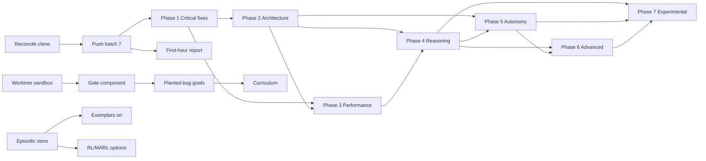

# ETHER full system audit — 2026-11-22

Branch `ether-audit-docs` (from `ether-batch7` @ `c8003135c9`, batches 2–7, unpushed). Live code: `origin/main` @ `ceb6c9ab49` (2026-11-22 10:29 ET). Read-only audit plus one local PoC in `/tmp`; nothing pushed; GOPHER and matrix untouched. Times are America/Toronto (ET).

Doctrine held: single writer `scripts/host_main.py` under `host_supervisor`; Matrix read-only; tool-first; honest gate only (tool edit + target test + 0 regressions, no generate-fallback PASS); GTX 1650 4 GB + `qwen3.5:4b`; no second installer; updates by `git pull`; learning from honest-gate reward only. Any item that would change doctrine is labelled **doctrine change (owner decision)**.

Labels: **measured** = produced by a command in this audit or a cited artifact; **code-verified** = read in the source at the cited file:line; **estimate** = reasoned figure, to be replaced by host data.

## 0. Method and inputs

- Ran the full suite on the batch 7 tree: **1,947 tests, 1,790 pass, 74 fail, 83 skip, 348 s** (`pytest tests -q -p no:cacheprovider`, box venv). Matches `docs/results/batch7/tests_summary.json`; 0 dirty paths after.
- Static import reachability from `scripts/host_main.py` + `scripts/host_supervisor.py` over all non-test modules (over-approximate: any import counts).
- Timed the real regression guard (`goal_source.guard_suite` + `run_pytest`) on 8 seed goals.
- PoC: called `core.agent.react.react()` with a scripted model reply in a temp dir (`/tmp/poc`).
- Read live state from `origin/main` artifacts (`host_main.json`, `supervisor.json`, `git_push.json`, `sota.json`, `unison.json`) and commit history.
- Reused, not redone: `docs/AUDIT_SOTA_2026-11-19*.md`, `AUDIT_SOTA_2026-11-21_B5/B6.md`, `docs/SELF_IMPROVE_ARCH.md`, `docs/BANDITS.md`, `docs/results/batch3..7`, and `docs/AUDIT_INTEGRATION_2026-11-21.md` (branch `ether-batch6-docs`). The RL and MARL studies are still in progress on other branches; their results are not in this report.
- **Owner's attachment:** the brief says a file describing desired behaviour was attached. No attachment reached the box (`/workspace/uploads` does not exist) and `UNIFIED.md` is absent on both trees. Intent was taken from the owner's message (three pillars) and `ETHER.md`, `PRODUCT.md`, `docs/architecture.md`, `docs/gems.md`, `docs/BLUEPRINT_7_PHASES.md`. Please re-send the attachment; any requirement in it is not covered here.
- Note on age: the brief says 7 days of development; the repo's first commit is 2026-07-24 and `origin/main` has 44,431 commits. The 7 days likely refers to the current host_main era (supervisor started 2026-11-19).

## 1. Executive summary

**Verdict: not yet a living autonomous agent, and not competitive with Claude Code, Kimi Code, Cursor, OpenHands, SWE-agent or Aider on user tasks. It has one asset most hobby agents lack: an honest, test-based reward loop with a real single-writer runtime.** The batch 2–7 bundle turns that loop into a learner on paper; on the host today it learns nothing.

Five facts drive the verdict:

1. **Nothing learns on the host right now (measured).** `next_goal=none`, `queue empty`, `plan_error=ImportError`; last kept goal 2026-11-19 5:45 PM ET; 76 of 92 kept goals are `describe_*` filler. The supervisor's `git pull` fails every cycle (rc 128, local branch ahead 1 and diverged), so **the batch 7 push will not reach the host until the clone is reconciled.**
2. **The honest gate has two holes (code-verified, one PoC'd).** (a) The live ReAct tool router lets model output edit any file (including `tests/`) and run arbitrary Python; a test edit survives the revert, so a target can be made to pass by weakening its test. (b) The regression guard runs 36–79 of 1,947 tests (2–4%) per attempt, and a baseline timeout disables it entirely.
3. **'Verified Execution — sandboxed' is false on the live path.** Edits and pytest run in place in the writer's checkout with the owner's privileges and full environment (incl. the push token), no network block. The Docker sandbox (Clear Quartz) is legacy-only.
4. **Most of the system is not the system.** 73% of modules (56.6k of 81.3k LOC) are unreachable from the writer; 'eight gems with strongly-typed interfaces' run on the live path as five string rules; swarm is plan-only, LSP a stub, MCP servers unwired, no web tool. 60% of seed goals target dead code.
5. **The learning loop is narrow and finite.** One learned decision (which of 5–7 prompt variants), greedy decoding, no memory (exemplars off), and a 60-goal pool that runs dry in about 6 h (estimate).

**Ranked top 10 findings**

1. Host clone diverged; pull rc 128 every cycle; push will not land (measured).
2. Model tool calls can edit tests/any file and execute code; reward-hack route (PoC).
3. No sandbox on the live path; secrets in the test env (code-verified).
4. Regression guard covers 2–4% of tests; baseline timeout disables it (measured / code-verified).
5. Host makes zero progress; old code (measured).
6. Finite curriculum: pool dry in about 6 h after push (estimate).
7. 73% of code unreachable; 60% of goals on dead code (measured).
8. No memory, greedy decoding, 2-turn ReAct with 5 toy tools (code-verified).
9. Pillar claims (8 typed gems, swarm, MCP, LSP, web) mostly aspirational (code-verified).
10. Git used as telemetry bus: 5,452 commits/24 h, 3.5% of history touches code; Face stale since Sep 30 (measured).

**The 3 most critical fixes**

1. **Reconcile the host clone and make pull failures count** (0.5–1 d). Without it nothing else reaches the 1650. One-time: on the 1650 confirm the 1 local-ahead commit touches only `artifacts/`, then `git reset --keep origin/main`. Code: classify and auto-reconcile in `host_supervisor.git_pull`; increment `failures` on pull rc≠0.
2. **Close the reward-hacking route** (0.5 d): remove `edit`/`test` from the model-callable skills on the real path, and make the gate reject any attempt whose tree diff touches a path other than `goal['file']`.
3. **Make the gate trustworthy** (2–3 d): abort on empty/timed-out baseline (0.25 d), run attempts in a disposable worktree with a scrubbed env, and use transitive affected-test selection plus a nightly full-suite blame/revert.

**What to do first after the batch 7 push** (in order)

1. Before the push: reconcile the 1650 clone (fix 1, manual step). 2. Push `ether-batch7`; start with `ETHER_EXEMPLARS=record`. 3. Confirm `supervisor.json` shows `pull.ok=true` and HEAD = the new tip within one cycle. 4. Run `python scripts\first_hour_report.py --fetch` at +1 h and +6 h; targets kept/attempt > 0, revert ≤ 0.8, no arm > 0.6 share, ≤ 12 commits/h, filler 0. 5. Ship batch 8 = fixes 2 and 3 + temperature schedule + duplicate skip + health worst-of + Matrix learning read model, each behind a flag and measured as an arm where it changes prompts or decoding. 6. Start the planted-bug generator before the pool runs dry (hour 6).

## 2. Live state (origin/main, 2026-11-22 10:29 ET)

| Signal | Value | Source |
|---|---|---|
| Host tick | alive, 10:28 ET; Ollama up | `artifacts/host_main.json` |
| next_goal / queue | none / 'queue empty' | `host_main.json sota` |
| plan_error | ImportError (bare name; pre-batch-5 code) | `host_main.json` |
| Supervisor | cycle 7,691, failures 0, started 2026-11-19 5:13 PM ET | `artifacts/supervisor.json` |
| Pull | rc 128, HEAD 3abe0844 (not on origin), moved=false | `supervisor.json last.pull` |
| Publish | ahead=1, every push via worktree from origin/main | `artifacts/git_push.json` |
| Kept goals | 92 total, 76 describe_* filler; last kept 2026-11-19 5:45 PM ET | `artifacts/sota.json` |
| Face | unison.json app_alive_ts 2026-09-30, writer 'exe', stale=true | `artifacts/unison.json` |
| learning_summary.json | absent on origin | `git show` |
| Commits | 5,452 in last 24 h; 44,431 total; 1,566 touch .py | `git rev-list` |
| Bundle | 29 commits on c8dde296ea; 133 .py files changed, +10,292/−490 | `git diff --stat` |

**Root cause of rc 128 (code-verified + measured):** once the host's local `main` is ahead of origin, `origin_publish.publish_plan()` (`scripts/origin_publish.py:348-350`) switches to a worktree push from `origin/main` and never reconciles the local branch. The supervisor's `git pull --ff-only` (`scripts/host_supervisor.py:210`) then fails on every cycle, and `failures` (`:401`) counts only the tick's exit code, so state stays 'running, 0 failures'.

## 3. Pillar reality check

| Claim | What the code does | Status |
|---|---|---|
| 8 specialized gems with strongly-typed interfaces | Pydantic request/response envelopes exist (`core/schemas.py`) and `GemRegistry` routes them in the legacy pipeline. On the live real-goal path the 'bag' is `core/agent/gems.py:99-128`: five string rules. `gems/protocol.py:19-28` itself labels Selenite and Amethyst 'theatre', five 'partial', Clear Quartz 'live'. | partial / legacy-only |
| Verified Execution: sandboxed, tested, scored before the user sees it | Tested and scored: yes (honest gate). Sandboxed: no on the live path — in-place edits and pytest with full env (`goal_source.py:87-93,158-211,1208`). Clear Quartz Docker is legacy-only. | tested yes / sandbox no |
| Controlled Evolution: template-based tool generation | `gems/grandidierite/fabricate.py` is stub-only with `ETHER_AUTO_PROMOTE=0`; `ether_evolve.cycle()` runs only on non-Windows (`host_main.py:281-287`), so never on the 1650. Two real bugs in Grandidierite templates (batch 6). | not live |
| Agent swarm | `core/phase4_swarm_plan.py`: 'plan-only… does not spawn processes or call GPU'. `PRODUCT.md` lists 'a swarm' under 'Not this product'. | absent; doctrine conflict |
| Toolkit / skills | 5 skills (`core/agent/skills.py`): search (core/ only, 3 hits), read (600 chars), remember, edit, test. | minimal, unsafe |
| MCP | In-process MCP servers for citrine, clear_quartz, labradorite + `core/mcp_client.py`; not called on the real path. | built, unwired |
| LSP | `core/loop/lsp.py` returns `no_lsp_server`; `lsp_client.py` falls back to AST hover; neither on the real path. | stub |
| Web connect / API | No web search or fetch tool in the codebase; Rose Quartz has an optional cloud burst (unused on the live path, against local-first). | absent |
| Self-learn, self-evolve daily | After the push: Thompson bandit over 5–7 prompt arms from gate reward; exemplars in record mode; no curriculum growth. | narrow, finite |

**Doctrine conflict for owner decision:** the owner's vision includes an *agent swarm*; `PRODUCT.md` says a swarm is not this product. A doctrine-compatible reading is CPU-side workers (scanner, test runner, planted-bug generator) under the supervisor that never write, with `host_main` the only writer. A GPU multi-agent swarm is not feasible on 4 GB with one model loaded and would need a doctrine change.

## 4. Subsystem scorecard

Score 0–10 against SOTA coding agents on the live path (estimate, auditor judgement).

| # | Subsystem | Score | Verdict | Weaknesses |
|---|---|---|---|---|
| 1 | Overall Architecture | 3/10 | Single-writer core is sound; 73% of code unreachable, 7 loops, 5 provider stacks. | W11, W38, W42, W43, W54, W66 |
| 2 | Prompt Stack | 3/10 | Two hard-coded strings; no contract, no versioning, mixed protocols. | W12, W48, W68, W100 |
| 3 | Agent Loop | 4/10 | Honest gate loop is real and simple; T=0, 2-turn ReAct, tool router is a security hole. | W3, W8, W49, W88 |
| 4 | Planning | 2/10 | Constant plan; finite goal pool; 60% of goals on dead code. | W7, W10, W27, W77, W82, W89 |
| 5 | Context Engine | 4/10 | Budgeted, spoiler-guarded prompts; no repo map, tail truncation, two ctx knobs. | W40, W57, W81 |
| 6 | Tool System | 2/10 | 5 toy skills; search core/ only; read 600 chars; unsafe edit/test. | W13, W56, W67 |
| 7 | File Editing | 4/10 | AST-located function/span edits that compile; no diff format; not atomic. | W22, W34, W59, W87 |
| 8 | Repository Intelligence | 3/10 | SBFL + traceback targeting works (0.56 host target); no map or coverage store. | W23, W46, W58, W64 |
| 9 | Memory | 2/10 | Nothing on the live path; 6 disconnected stores; exemplars flagged off. | W9, W44, W60, W86 |
| 10 | Reflection | 1/10 | Raw pytest tail as feedback; Labradorite is a startswith check. | W26, W55, W83 |
| 11 | Subagents | 1/10 | None; swarm is plan-only. | W15, W72, W84, W99 |
| 12 | Hooks | 1/10 | None on the writer path. | W25, W63, W94 |
| 13 | Provider Layer | 3/10 | Works with Ollama; no retry, telemetry or routing. | W31, W71, W75, W78, W97 |
| 14 | User Experience | 2/10 | No task intake or review; Face stale since Sept 30. | W19, W28, W50, W80, W85, W95 |
| 15 | Performance | 3/10 | Budgeted for 4 GB; serial gate dominates; git telemetry churn. | W17, W32, W52, W70, W79, W92 |
| 16 | Reliability | 3/10 | Supervisor + backoff + selfcheck in bundle; host diverged; swallowed errors. | W2, W16, W33, W41, W47, W53, W61, W76, W90, W98 |
| 17 | Security | 2/10 | Model can write any file and run code unsandboxed; leftover POST API. | W1, W4, W14, W18, W35, W36, W37, W62, W91 |
| 18 | Evaluation | 5/10 | Honest gate, mutation bench, OPE logging are above typical hobby agents; guard covers 2-4%. | W5, W6, W20, W21, W39, W45, W51, W65, W73, W93 |
| 19 | Missing Capabilities | 2/10 | Most SOTA agent features absent on the live path. | W24, W29, W74, W96 |
| 20 | Competitive Gap | 2/10 | Not competitive on user tasks; potentially unique on honest self-improvement. | W30, W69 |

Mean 2.6/10. The strongest area is Evaluation (honest gate, mutation bench, propensity logging); the weakest are Reflection, Subagents and Hooks (none on the live path).

## 5. Deliverable 1 — Top 100 weaknesses (ranked by severity, then priority)

Each entry: severity · priority · eng time · difficulty; impact (labelled); likelihood; root cause; failure scenario; fix + justification; expected improvement; evidence.

### W1. Model output can edit any repo file and run arbitrary code through the live ReAct tool router

- **Subsystem:** 17 Security · **Severity:** critical · **Priority:** P0 · **Eng time:** 0.5 d · **Difficulty:** low
- **Impact:** Measured: PoC on the box edited tests/test_t.py and wrote a file via the `test` skill in one react() call. Any tool edit to a test survives the revert (revert restores only goal['file']).
- **Likelihood:** medium (needs a JSON tool call in a reply; prompt-injection from pasted source raises it)
- **Root cause:** skills.SKILLS exposes `edit` (sota.edit: any path under root, no protected-path check) and `test` (writes model code to sota_ws/tests and runs pytest with full env). react() executes any JSON with a 'tool' key on the real-goal path.
- **Failure scenario:** 4B replies {"tool":"edit","args":{"rel":"tests/test_x.py","old":"assert f(2)==4","new":"assert True"}} -> target passes -> gate keeps -> publish pushes the 'fix'; the test edit stays on disk.
- **Fix:** Real path gets a read-only tool set (search, read, outline). Delete edit/test from SKILLS or gate them behind protected(). Gate adds a tree-diff check: reject unless the only changed path is goal['file'].
- **Expected improvement:** Closes the only verified reward-hacking route around the honest gate.
- **Evidence:** core/agent/react.py:15-52; core/agent/skills.py:57-86; core/agent/sota.py:289-324; sota.py:481 (react on real path)

### W2. Host clone is diverged; supervisor pull fails every cycle, so the batch 7 push will not land

- **Subsystem:** 16 Reliability · **Severity:** critical · **Priority:** P0 · **Eng time:** 0.5-1 d · **Difficulty:** low
- **Impact:** Measured on origin 10:29 ET: supervisor.json cycle 7,691 pull rc 128, HEAD 3abe0844 (not on origin), failures 0; git_push.json ahead=1, every publish goes via worktree.
- **Likelihood:** certain (happening now)
- **Root cause:** Once the local branch is ahead (an unpushed local commit), publish_plan() routes around it with a worktree push from origin/main and never reconciles; `git pull --ff-only` then fails forever. Pull failure is not counted in `failures`.
- **Failure scenario:** Owner pushes batch 7; the host keeps running pre-batch-2 code indefinitely while dashboards say 'running, 0 failures'.
- **Fix:** On rc!=0: fetch, classify local-ahead commits; if they touch only artifacts/ do `git reset --keep origin/main`, else rebase --autostash and pin. Count pull failures toward health and backoff. One-time manual reset on the 1650 now.
- **Expected improvement:** Unblocks every bundled improvement reaching the host.
- **Evidence:** scripts/host_supervisor.py:184-215,390-402; scripts/origin_publish.py:348-350,389-396

### W3. The live host makes zero learning progress

- **Subsystem:** 3 Agent Loop · **Severity:** critical · **Priority:** P0 · **Eng time:** 0 (push) + W2 · **Difficulty:** low
- **Impact:** Measured: host_main.json 15:28 UTC next_goal=none, sota 'queue empty', plan_error=ImportError; last kept goal 2026-11-19 22:45 UTC; 76 of 92 kept goals are describe_* filler.
- **Likelihood:** certain
- **Root cause:** Origin still runs pre-batch-2 code (finite legacy ladder, deleted heartbeat_plan). Batches 2-7 are unpushed.
- **Failure scenario:** Every hour: about 230 artifact commits, 0 kept edits, 0 learning.
- **Fix:** Fix W2, push batch 7, run first_hour_report at +1 h and +6 h.
- **Expected improvement:** Turns the host from heartbeat-only into a learner.
- **Evidence:** `origin/main artifacts/host_main.json, artifacts/sota.json`

### W4. 'Verified Execution: every artifact sandboxed' is false on the live path

- **Subsystem:** 17 Security · **Severity:** critical · **Priority:** P0 · **Eng time:** 3-5 d · **Difficulty:** medium
- **Impact:** Measured: real-goal edits are written into the writer's own checkout and pytest runs there with cwd=root and a copy of os.environ; no container, no network block.
- **Likelihood:** certain
- **Root cause:** Clear Quartz (Docker) is only used by the legacy pipeline. goal_source.run_pytest and apply_edit work in place.
- **Failure scenario:** A model-written function that calls shutil.rmtree or opens a socket runs with the owner's privileges during the gate; a crash between apply and revert leaves broken source in the writer tree.
- **Fix:** Run every attempt in a disposable git worktree (core/kernel/worktree.py exists) under a Windows Job Object with no network and a scrubbed env; apply the patch to the main tree only after the gate passes.
- **Expected improvement:** Pillar 2 becomes true; crash-safety for the writer tree.
- **Evidence:** core/agent/goal_source.py:87-93,158-211,1208; gems/clear_quartz/sandbox.py (not imported on real path)

### W5. Regression guard sees 2-4% of the suite

- **Subsystem:** 18 Evaluation · **Severity:** critical · **Priority:** P0 · **Eng time:** 2-3 d · **Difficulty:** medium
- **Impact:** Measured on 8 seed goals: guard suites of 4-9 files ran 36-79 tests out of 1,947.
- **Likelihood:** high
- **Root cause:** guard_suite = target file + at most 6 smallest direct importers (regex on 'from mod import') + 2 smoke files. Transitive importers and behaviour tests are never run.
- **Failure scenario:** An edit to core/registry.py passes its 59 guard tests and breaks a pipeline test two imports away; it is kept and pushed.
- **Fix:** Transitive import graph selection (cached), plus a full-suite sweep every N keeps that blames and reverts the culprit kept edit.
- **Expected improvement:** Real '0 regressions'; protects main from slow rot.
- **Evidence:** `core/agent/goal_source.py:1214-1241`

### W6. A baseline timeout silently turns the regression gate off

- **Subsystem:** 18 Evaluation · **Severity:** critical · **Priority:** P0 · **Eng time:** 0.25 d · **Difficulty:** low
- **Impact:** Code-verified: run_pytest returns status {} on TimeoutExpired; regressions({}, after) == [] so the gate checks only the target.
- **Likelihood:** low-medium (180 s timeout; slow Windows runs)
- **Root cause:** No check that the baseline run produced results before comparing.
- **Failure scenario:** Baseline guard run times out under load; the edit passes the target and breaks 20 tests; kept.
- **Fix:** Abort the attempt (infra, not a lesson) when baseline rc==-9 or status is empty; same for the after run.
- **Expected improvement:** Removes a silent hole in the only reward.
- **Evidence:** core/agent/goal_source.py:182-184,1244-1245; core/agent/sota.py:425-427

### W7. Finite curriculum: the goal pool runs dry in hours

- **Subsystem:** 4 Planning · **Severity:** critical · **Priority:** P0 · **Eng time:** 3-5 d · **Difficulty:** medium
- **Impact:** Estimate (SELF_IMPROVE_ARCH §2): 60 seed goals x <=3 tries, about 360 attempt slots, about 6 h at 60 attempts/h.
- **Likelihood:** certain after push
- **Root cause:** Goals come only from currently failing tests and 3 ruff rules; nothing creates new verifiable tasks.
- **Failure scenario:** Hour 7 after the push: queue empty again, bandit frozen, Matrix shows idle.
- **Fix:** Planted-bug generator on reachable code (SWE-smith style mutants with a known failing test), type-check and coverage goals, owner issue intake.
- **Expected improvement:** Unbounded supply of honest-gate tasks; the precondition for daily self-improvement.
- **Evidence:** core/agent/goal_source.py:878-899; config/goal_seed.json

### W8. Every real attempt is greedy (temperature 0)

- **Subsystem:** 3 Agent Loop · **Severity:** high · **Priority:** P0 · **Eng time:** 0.5 d · **Difficulty:** low
- **Impact:** Code-verified; gain estimate from SELF_IMPROVE_ARCH: +20-50% relative pass@6 if duplicates are common.
- **Likelihood:** certain
- **Root cause:** _ask() default temperature=0 and host_main._code never overrides it.
- **Failure scenario:** 6 tries on one goal return the same wrong function 6 times; 5 gate runs wasted.
- **Fix:** Try-indexed temperature (0, 0.6, 0.8) plus duplicate-reply skip by hash before running the gate.
- **Expected improvement:** More distinct candidates per GPU-hour.
- **Evidence:** scripts/live_edit_tx.py:27,38; scripts/host_main.py:145-146

### W9. Kept edits are forgotten: no memory on the real path

- **Subsystem:** 9 Memory · **Severity:** high · **Priority:** P0 · **Eng time:** 0 (flag) / 2 d · **Difficulty:** low
- **Impact:** Code-verified: build_prompt has no memory input; batch 7 exemplars exist but ETHER_EXEMPLARS=0 by default.
- **Likelihood:** certain
- **Root cause:** Memory systems were built for the legacy pipeline only.
- **Failure scenario:** ETHER fixes clamp_low, then fails floor_at (same max() pattern) 6 times.
- **Fix:** Run ETHER_EXEMPLARS=record from the push, flip to 1 when the A/B clears P(better)>=0.9.
- **Expected improvement:** Literature: AWM +24.6% / ExpeL gains; ETHER estimate +10-30% relative kept/attempt.
- **Evidence:** core/agent/goal_source.py:955-1015; core/agent/exemplars.py

### W10. 60% of goals target code the writer never runs

- **Subsystem:** 4 Planning · **Severity:** high · **Priority:** P1 · **Eng time:** 1 d · **Difficulty:** low
- **Impact:** Measured: 36 of 60 seed goals target modules not statically reachable from host_main/host_supervisor (core/pipeline.py x9, core/registry.py x7, core/experience.py x4).
- **Likelihood:** certain
- **Root cause:** Goal ranking ignores whether the target is live code.
- **Failure scenario:** ETHER spends its scarce GPU hours fixing a dead pipeline and reports progress that changes nothing.
- **Fix:** Weight goals by reachability and call frequency; move dead modules to a quarantine package so their tests stop generating goals.
- **Expected improvement:** Learning effort lands on the product.
- **Evidence:** `config/goal_seed.json vs static import graph (this audit)`

### W11. 73% of the codebase is unreachable from the writer

- **Subsystem:** 1 Overall Architecture · **Severity:** high · **Priority:** P1 · **Eng time:** 2-4 wk · **Difficulty:** high
- **Impact:** Measured (static, over-approximate): 382 of 523 modules and 56.6k of 81.3k LOC are not imported from host_main/host_supervisor; 31 phase*_status modules, 0 reachable; about 7 agent loops, 5 provider stacks, 6 memory stores.
- **Likelihood:** certain
- **Root cause:** Each phase added a new loop instead of replacing the old one; nothing is deleted.
- **Failure scenario:** A fix lands in core/agent_loop.py, which nothing calls; goal and test noise grows with every dead module.
- **Fix:** Strangler deletion: freeze an allowlist of live modules, move the rest to legacy/ with its tests, delete after 2 weeks of no imports.
- **Expected improvement:** Smaller attack surface, faster tests, cleaner goals.
- **Evidence:** /tmp reachability scan (this audit); core/agent_loop.py, core/pipeline.py, core/orchestrator.py, core/chat_orchestrator.py

### W12. Prompt stack is two hard-coded strings

- **Subsystem:** 2 Prompt Stack · **Severity:** high · **Priority:** P1 · **Eng time:** 1 d · **Difficulty:** low
- **Impact:** Code-verified: SYSTEM and EDIT in core/kernel/agent_prompt.py are 4-5 lines; no repo conventions, no output contract, no examples.
- **Likelihood:** certain
- **Root cause:** 'Short because the context budget is the product' traded clarity for chars.
- **Failure scenario:** The 4B answers with a markdown fence or a class wrapper; extract_edit fails and a try is burned on 'no function'.
- **Fix:** Versioned prompt registry with an explicit output contract, one fixed micro-example, and failure-type-specific repair prompts; A/B each through the bandit.
- **Expected improvement:** Fewer format failures; prompts become an evolvable, measured artefact.
- **Evidence:** `core/kernel/agent_prompt.py`

### W13. Live tool surface is 5 toy skills

- **Subsystem:** 6 Tool System · **Severity:** high · **Priority:** P1 · **Eng time:** 2-3 d · **Difficulty:** medium
- **Impact:** Code-verified: search scans only core/ and stops at 3 hits; read returns the first 600 chars; no grep, glob, outline, run-one-test or git diff.
- **Likelihood:** certain
- **Root cause:** Tools were sized for the describe ladder, not for real bugs.
- **Failure scenario:** Goal in scripts/ or gems/ (10 of 60 seed goals): search returns nothing; read shows the license header.
- **Fix:** ACI-style tools: grep with line numbers, symbol outline, read range, run_test(nodeid), show_diff, all read-only and capped.
- **Expected improvement:** Agent can investigate before editing, like SWE-agent.
- **Evidence:** `core/agent/skills.py:11-46`

### W14. Black Tourmaline on the live path is a substring check

- **Subsystem:** 17 Security · **Severity:** high · **Priority:** P1 · **Eng time:** 1 d · **Difficulty:** low
- **Impact:** Code-verified: blocks any reply containing 'subprocess', 'os.system' or '__import__'.
- **Likelihood:** high
- **Root cause:** Security gem reduced to three string matches.
- **Failure scenario:** A correct fix to a function that already calls subprocess.run is blocked; os.popen or shutil.rmtree pass.
- **Fix:** Replace with AST policy (calls, imports, file and network APIs) scoped to the diff, not the whole reply; rely on the sandbox (W4) as the real boundary.
- **Expected improvement:** Fewer false blocks, real policy.
- **Evidence:** `core/agent/gems.py:72-78`

### W15. '8 gems with strongly-typed interfaces' is not what runs

- **Subsystem:** 11 Subagents · **Severity:** high · **Priority:** P1 · **Eng time:** n/a (decision) · **Difficulty:** low
- **Impact:** Code-verified: the live bag is 5 string rules; gems.protocol labels selenite and amethyst 'theatre', 5 'partial', 1 'live'. Pydantic envelopes (core/schemas.py) are used only by GemRegistry in the legacy pipeline.
- **Likelihood:** certain
- **Root cause:** Gems were designed for the legacy pipeline; the real-goal loop bypasses them.
- **Failure scenario:** Owner believes Labradorite critiques every edit; on the live path it checks text.startswith('def ').
- **Fix:** Either wire typed gem calls into the real loop where they add measured value, or relabel gems honestly in docs and Matrix.
- **Expected improvement:** Honest architecture; decisions can be learned per gem later.
- **Evidence:** gems/protocol.py:19-28; core/agent/gems.py:99-128

### W16. Errors are swallowed everywhere

- **Subsystem:** 16 Reliability · **Severity:** high · **Priority:** P1 · **Eng time:** 3-5 d · **Difficulty:** medium
- **Impact:** Measured: 1,053 'except Exception' in non-test code, 215 followed directly by pass. A bare ImportError hid the deleted heartbeat_plan for 12 days (host_main.py:43).
- **Likelihood:** high
- **Root cause:** Fail-soft by default to keep the loop alive.
- **Failure scenario:** A refactor breaks goal_source import; host_main records runtime_error and keeps publishing 'healthy'.
- **Fix:** Typed error taxonomy (infra / model / gate / bug); unknown exceptions escalate health to degraded and appear on the Matrix; error budget per hour.
- **Expected improvement:** Faults surface in minutes instead of days.
- **Evidence:** rg count (this audit); scripts/host_main.py:122-290

### W17. Git is used as a telemetry bus

- **Subsystem:** 15 Performance · **Severity:** high · **Priority:** P1 · **Eng time:** 1-2 d · **Difficulty:** medium
- **Impact:** Measured: 5,452 commits in the last 24 h; 44,431 total, only 1,566 (3.5%) touch .py; 361,798 objects / 63 MB of packs. publish() runs twice per tick.
- **Likelihood:** certain
- **Root cause:** Artifacts are the only channel to the Matrix.
- **Failure scenario:** Rebase conflicts on artifacts cause the divergence in W2; history is unusable for code archaeology.
- **Fix:** Keep the 300 s throttle (batch 5), then move heartbeats to an orphan 'telemetry' branch or a single force-updated gist; main gets code and daily summaries only.
- **Expected improvement:** Clean history, fewer conflicts, smaller clones.
- **Evidence:** scripts/host_main.py:199,278; git rev-list counts (this audit)

### W18. Leftover dashboard has unauthenticated write routes

- **Subsystem:** 17 Security · **Severity:** high · **Priority:** P1 · **Eng time:** 0.5 d · **Difficulty:** low
- **Impact:** Code-verified: 10 POST routes in dashboard/app.py incl. /api/promote, /api/reconcile-tools, /api/test, /api/upload, /api/chat; cli `ether dashboard --host` can bind any interface.
- **Likelihood:** low (not started by the supervisor)
- **Root cause:** The retired :8787 app was never stripped.
- **Failure scenario:** Someone runs `ether dashboard`; a malicious web page POSTs to 127.0.0.1:8787/api/promote (CSRF / DNS rebinding).
- **Fix:** Delete the POST routes (Matrix is read-only) or require a local token and Origin check.
- **Expected improvement:** Doctrine and code agree.
- **Evidence:** dashboard/app.py:280-544; cli/main.py:420-428

### W19. The Face is stale and blind to learning

- **Subsystem:** 14 User Experience · **Severity:** high · **Priority:** P1 · **Eng time:** 2 d · **Difficulty:** low
- **Impact:** Measured: origin unison.json app_alive_ts 2026-09-30, writer 'exe', stale=true. Prior audit: Matrix reads no learning_summary, bandit or revert data.
- **Likelihood:** certain
- **Root cause:** snapshot() missing on origin; read model never extended.
- **Failure scenario:** Owner opens the Matrix after the push and still sees 'restore_1650_writer'.
- **Fix:** Batch-7-plus read model: learning_summary schema 2, arms, kept/revert, queue depth, pull status, capability truth table. Still read-only.
- **Expected improvement:** Owner can see learning happen.
- **Evidence:** origin artifacts/unison.json; scripts/unison.py

### W20. No external benchmark

- **Subsystem:** 18 Evaluation · **Severity:** high · **Priority:** P1 · **Eng time:** 1-2 wk · **Difficulty:** medium
- **Impact:** Code-verified: no SWE-bench, Aider polyglot or HumanEval run on the 1650; only self-generated goals.
- **Likelihood:** certain
- **Root cause:** Evaluation is internal by design.
- **Failure scenario:** ETHER claims SOTA progress with no way to compare against Aider or OpenHands on the same 4B.
- **Fix:** Fixed nightly micro-benchmark: 30 SWE-bench-Lite-style Python tasks that fit 4K ctx plus 30 held-out planted bugs; publish pass@1, pass@6, kept/GPU-h.
- **Expected improvement:** Comparable, regression-proof capability number.
- **Evidence:** scripts/bench.py; fixtures/

### W21. 74 standing test failures and 83 skips

- **Subsystem:** 18 Evaluation · **Severity:** high · **Priority:** P1 · **Eng time:** 2-3 d · **Difficulty:** medium
- **Impact:** Measured on batch 7: 1,947 tests, 1,790 pass, 74 fail, 83 skip, 348 s.
- **Likelihood:** certain
- **Root cause:** Failing tests are left as goals; some are design tests broken by later batches (test_bandit_design now sees 7 arms).
- **Failure scenario:** A real regression hides among 74 red tests; CI is never green.
- **Fix:** Triage into fix / xfail(reason, owner) / delete-with-module; CI requires 0 unexpected failures.
- **Expected improvement:** Green baseline; regressions visible.
- **Evidence:** `pytest run (this audit), docs/results/batch7/tests_summary.json`

### W22. Edits are whole-function rewrites

- **Subsystem:** 7 File Editing · **Severity:** high · **Priority:** P1 · **Eng time:** 3-5 d · **Difficulty:** medium
- **Impact:** Code-verified: one function (+<=4 constants) or a 6-30 line span; multi-file off by default; reply cap 240-768 tokens.
- **Likelihood:** certain
- **Root cause:** Format chosen to make extraction easy for a 4B.
- **Failure scenario:** A one-character off-by-one in a 120-line function needs the model to reproduce all 120 lines; it drops a branch and regresses.
- **Fix:** Add search/replace blocks (Aider format) as an edit arm, validated by exact-match, with function rewrite as fallback.
- **Expected improvement:** Smaller replies, fewer collateral changes; literature shows diff formats help strong models, measure for 4B.
- **Evidence:** core/agent/goal_source.py:1123-1209; core/agent/span_edit.py

### W23. No repository map on the real path

- **Subsystem:** 8 Repository Intelligence · **Severity:** high · **Priority:** P1 · **Eng time:** 3-5 d · **Difficulty:** medium
- **Impact:** Code-verified: the repo_map_on arm shows only top-level def/class/import lines of the same file.
- **Likelihood:** certain
- **Root cause:** Repo intelligence modules (symbol_index, rag_bm25, Citrine) are wired only to the legacy pipeline.
- **Failure scenario:** The bug is in a helper imported from another module; the prompt never shows it.
- **Fix:** Aider-style ranked repo map (tree-sitter or ast tags + PageRank over references) capped to 600 chars, offered as a bandit arm.
- **Expected improvement:** Cross-file bugs become fixable.
- **Evidence:** core/agent/goal_source.py:1001-1003; core/symbol_index.py

### W24. Swarm, LSP, MCP and web connect are mostly aspirational

- **Subsystem:** 19 Missing Capabilities · **Severity:** high · **Priority:** P2 · **Eng time:** n/a · **Difficulty:** medium
- **Impact:** Code-verified: phase4_swarm_plan 'plan-only, does not spawn processes'; core/loop/lsp.py is a fail-closed stub; MCP servers exist for citrine, clear_quartz, labradorite but nothing on the real path calls them; no web search tool exists.
- **Likelihood:** certain
- **Root cause:** Phase status modules record intent as completion.
- **Failure scenario:** A roadmap decision assumes MCP tools are available to the agent; they are not.
- **Fix:** Publish a capability truth table (live / flag / stub / absent) generated from code and shown in the Matrix.
- **Expected improvement:** Planning on facts.
- **Evidence:** core/phase4_swarm_plan.py:1-5; core/loop/lsp.py; gems/*/mcp_server.py

### W25. No lifecycle hooks on the writer path

- **Subsystem:** 12 Hooks · **Severity:** high · **Priority:** P2 · **Eng time:** 3 d · **Difficulty:** medium
- **Impact:** Code-verified: core/kernel/hooks.py is a 2 s thread-timeout wrapper; pipeline_hooks is unreachable.
- **Likelihood:** certain
- **Root cause:** Hooks were built for the legacy pipeline.
- **Failure scenario:** Owner wants 'ruff format before keep' or 'never touch gems/ on Fridays'; it needs a code change in sota.py.
- **Fix:** Declarative hooks (pre_prompt, pre_edit, post_edit, pre_keep, post_keep, on_fail) loaded from config, run in the sandbox with timeouts, able to veto.
- **Expected improvement:** Policy without code edits; parity with Claude Code hooks.
- **Evidence:** `core/kernel/hooks.py`

### W26. No reflection on the real path

- **Subsystem:** 10 Reflection · **Severity:** high · **Priority:** P2 · **Eng time:** 2-3 d · **Difficulty:** medium
- **Impact:** Code-verified: retry feedback is the last 400 chars of pytest output or 'no function'; doctrine 'Labradorite critique before a second hypothesis' is not implemented.
- **Likelihood:** certain
- **Root cause:** Reflection lives in core/critique_* and Labradorite, both legacy-only.
- **Failure scenario:** Same wrong hypothesis retried 6 times.
- **Fix:** Cheap structured reflection: classify the failure (syntax / wrong target / assertion delta / regression) and emit a one-line hypothesis that must differ from the last; Reflexion-style, gated by the bandit.
- **Expected improvement:** Diverse retries; literature: Reflexion gains on HumanEval.
- **Evidence:** core/agent/sota.py:491-531; ETHER.md doctrine

### W27. No planner on the real path

- **Subsystem:** 4 Planning · **Severity:** high · **Priority:** P2 · **Eng time:** 1 wk · **Difficulty:** medium
- **Impact:** Code-verified: Selenite plan() returns a constant ['search','edit','test']; one target symbol picked by SBFL.
- **Likelihood:** certain
- **Root cause:** Planning deferred to the legacy pipeline.
- **Failure scenario:** A failure needs a constant change in module A and a call fix in module B; the loop tries only B.
- **Fix:** Agentless-style plan: localize (file -> function -> lines) with ranked hypotheses, then repair candidates, then select by tests.
- **Expected improvement:** Multi-site bugs fixable; literature: Agentless 27% SWE-bench Lite at low cost.
- **Evidence:** `core/agent/gems.py:33-38`

### W28. No user-facing coding UX

- **Subsystem:** 14 User Experience · **Severity:** high · **Priority:** P2 · **Eng time:** 2-3 wk · **Difficulty:** medium
- **Impact:** Code-verified: the owner cannot give the writer a task except through FIFO job files; `ether run` drives the legacy pipeline; no diff review or approval.
- **Likelihood:** certain
- **Root cause:** Product focus moved to self-improvement.
- **Failure scenario:** Owner wants 'fix bug X in my other repo'; there is no path.
- **Fix:** Task intake (GitHub issue label or Matrix-readable queue file), per-task branch, diff summary, owner approval before merge.
- **Expected improvement:** ETHER becomes useful to its owner.
- **Evidence:** cli/main.py; scripts/drain_live_fifo.py

### W29. ETHER only edits itself

- **Subsystem:** 19 Missing Capabilities · **Severity:** high · **Priority:** P2 · **Eng time:** 2-4 wk · **Difficulty:** high
- **Impact:** Code-verified: goal_source scans ETHER's own tests; no external repo path.
- **Likelihood:** certain
- **Root cause:** Self-improvement focus.
- **Failure scenario:** Owner cannot point ETHER at another project.
- **Fix:** Workspace abstraction: target repo + its test command; same honest gate.
- **Expected improvement:** General coding agent.
- **Evidence:** `core/agent/goal_source.py:816-858`

### W30. No measured position against SOTA

- **Subsystem:** 20 Competitive Gap · **Severity:** high · **Priority:** P2 · **Eng time:** n/a · **Difficulty:** high
- **Impact:** Estimate: frontier-model agents report 60-75% on SWE-bench Verified; small local models report far lower; ETHER has no number.
- **Likelihood:** certain
- **Root cause:** No benchmark (W22).
- **Failure scenario:** Roadmap cannot be prioritised by gap size.
- **Fix:** Run the micro-benchmark (I-list) with the same harness for ETHER and an Aider baseline on qwen3.5:4b.
- **Expected improvement:** Honest gap estimate.
- **Evidence:** `n/a`

### W31. Provider layer is raw urllib with no retry or telemetry

- **Subsystem:** 13 Provider Layer · **Severity:** medium · **Priority:** P1 · **Eng time:** 1-2 d · **Difficulty:** low
- **Impact:** Code-verified: POST to hard-coded 127.0.0.1:11434, no retry/backoff, no streaming, no keep_alive, eval counts discarded; 4 other router stacks unused.
- **Likelihood:** medium
- **Root cause:** Minimal client written for one probe and reused.
- **Failure scenario:** Ollama returns 500 after an OOM; the attempt is marked infra and the tick ends; nobody knows tokens/s.
- **Fix:** One provider module: retries with jitter, keep_alive, OLLAMA_HOST, timeouts from token caps, and a record of prompt_eval_count/eval_count/durations per call.
- **Expected improvement:** Robust calls and real latency data.
- **Evidence:** scripts/live_edit_tx.py:27-56; scripts/live_generate_probe.py:16-27

### W32. Each attempt pays two fresh pytest runs

- **Subsystem:** 15 Performance · **Severity:** medium · **Priority:** P1 · **Eng time:** 1-2 d · **Difficulty:** medium
- **Impact:** Measured on the box: 6.9-23.6 s per guard run (median 7.4 s) x2 per attempt; baseline not cached across tries of the same goal.
- **Likelihood:** certain
- **Root cause:** Simplicity; pytest re-collects every time.
- **Failure scenario:** On the 1650's CPU the gate costs more than the model call.
- **Fix:** Cache the baseline per (goal, tree hash); run the target test first and stop early on failure; keep a warm pytest worker (pytest-xdist or a persistent runner) per attempt.
- **Expected improvement:** Estimate 30-50% less wall time per attempt.
- **Evidence:** core/agent/goal_source.py:158-211; sota.py:425-427

### W33. Health reports 'running, 0 failures' while nothing works

- **Subsystem:** 16 Reliability · **Severity:** medium · **Priority:** P1 · **Eng time:** 0.5 d · **Difficulty:** low
- **Impact:** Measured: supervisor failures=0 with pull rc 128 and queue empty.
- **Likelihood:** certain
- **Root cause:** failures counts only the tick process exit code.
- **Failure scenario:** Owner trusts the green state for days.
- **Fix:** Health = worst of (pull, selfcheck, plan, queue depth, kept in last 6 h); expose as one field the Matrix colours.
- **Expected improvement:** Problems visible at a glance.
- **Evidence:** `scripts/host_supervisor.py:401`

### W34. Writes and reverts are not atomic

- **Subsystem:** 7 File Editing · **Severity:** medium · **Priority:** P1 · **Eng time:** 0.5 d · **Difficulty:** low
- **Impact:** Code-verified: apply_edit and revert use path.write_text directly.
- **Likelihood:** low
- **Root cause:** Simplicity.
- **Failure scenario:** Power loss during revert leaves a half-written core module; next tick fails to import.
- **Fix:** Write to temp + os.replace; keep the original in a journal until the gate verdict is recorded.
- **Expected improvement:** Crash-safe edits.
- **Evidence:** core/agent/goal_source.py:1208; core/agent/sota.py:304-305

### W35. GitHub token on the push URL and in the test environment

- **Subsystem:** 17 Security · **Severity:** medium · **Priority:** P1 · **Eng time:** 0.5 d · **Difficulty:** low
- **Impact:** Code-verified: push_url embeds the token in argv; test_env copies os.environ into model-run pytest.
- **Likelihood:** medium
- **Root cause:** Git does not read GH_TOKEN; env copied wholesale.
- **Failure scenario:** A model-written function reads os.environ during the gate; with no network block (W4) it can exfiltrate.
- **Fix:** Credential helper or GIT_ASKPASS; scrub env for test subprocesses to an allowlist.
- **Expected improvement:** Secrets out of reach of model code.
- **Evidence:** scripts/origin_publish.py:11-14; core/agent/goal_source.py:87-93

### W36. Kept code edits auto-push to main with no review

- **Subsystem:** 17 Security · **Severity:** medium · **Priority:** P1 · **Eng time:** 0.5 d · **Difficulty:** low
- **Impact:** Code-verified: publish treats non-artifact paths as urgent and pushes immediately.
- **Likelihood:** certain
- **Root cause:** Autonomy by design.
- **Failure scenario:** A narrow-gate keep (W5) breaks main for every clone, including the owner's.
- **Fix:** Kept edits go to a 'host/kept' branch; a nightly full suite fast-forwards main. Doctrine-compatible: the host is still the only writer.
- **Expected improvement:** Main stays green.
- **Evidence:** `scripts/origin_publish.py:371-378`

### W37. Prompt-injection surface into the tool router

- **Subsystem:** 17 Security · **Severity:** medium · **Priority:** P1 · **Eng time:** 0.5 d · **Difficulty:** low
- **Impact:** Code-verified: file and test source are pasted verbatim and any JSON with 'tool' in the reply is executed.
- **Likelihood:** medium
- **Root cause:** No separation of data and instructions.
- **Failure scenario:** A docstring containing a tool JSON is echoed by the 4B and executed.
- **Fix:** Read-only tools (W1); only parse tool calls in investigation turns and only in a strict envelope.
- **Expected improvement:** Closes injection path.
- **Evidence:** `core/agent/skills.py:89-104`

### W38. Curriculum filler was written into production modules

- **Subsystem:** 1 Overall Architecture · **Severity:** medium · **Priority:** P1 · **Eng time:** 0.5 d (in bundle) · **Difficulty:** low
- **Impact:** Measured: 77 production .py files on origin define a toy describe(); core/kernel/context_budget.py still carries add/clamp/packed_count ladder fodder. The bundle removes 74 of the 77.
- **Likelihood:** certain
- **Root cause:** The legacy ladder rewarded adding trivial functions to real modules.
- **Failure scenario:** Code search and repo maps fill with noise; filler counts as 'kept'.
- **Fix:** Push batch 7; delete the remaining 3 and the ladder functions in context_budget.py; goal guard keeps filler at 0.
- **Expected improvement:** Clean modules, honest kept counts.
- **Evidence:** git grep 'def describe()' origin/main vs HEAD (this audit); core/kernel/context_budget.py:52-93

### W39. Lint goals pass on any passing test

- **Subsystem:** 18 Evaluation · **Severity:** medium · **Priority:** P1 · **Eng time:** 0.25 d · **Difficulty:** low
- **Impact:** Code-verified: for lint, target_ok = lint_clear and any(test passed).
- **Likelihood:** medium
- **Root cause:** Lint goals have no target test.
- **Failure scenario:** An edit silences F841 by deleting a used line; one unrelated guard test passes; kept unless that test regressed.
- **Fix:** Lint keep requires lint clear and the full guard suite at baseline or better, with at least one test importing the module.
- **Expected improvement:** Lint keeps become meaningful.
- **Evidence:** `core/agent/goal_source.py:1270-1271`

### W40. Two unrelated context knobs and a truncation that can cut the instruction

- **Subsystem:** 5 Context Engine · **Severity:** medium · **Priority:** P2 · **Eng time:** 0.5 d · **Difficulty:** low
- **Impact:** Code-verified: budget uses ETHER_MODEL_CTX (default 8192) at 4 chars/token while Ollama gets num_ctx 4096 and goal_source assumes 3.3 chars/token; build_prompt ends with prompt[:budget], which cuts the reply instruction first.
- **Likelihood:** low
- **Root cause:** Context budget predates num_ctx.
- **Failure scenario:** Feedback plus an exemplar push the prompt over budget; the 'Reply with one complete Python function' tail is cut.
- **Fix:** Derive the budget from num_ctx minus reply cap minus system tokens; trim middle sections, never the tail.
- **Expected improvement:** No silent truncation.
- **Evidence:** core/kernel/context_budget.py:7-10; core/agent/goal_source.py:1015; scripts/live_edit_tx.py:15-24

### W41. Windows-only learning, hard-coded paths and host identity

- **Subsystem:** 16 Reliability · **Severity:** medium · **Priority:** P2 · **Eng time:** 1 d · **Difficulty:** low
- **Impact:** Code-verified: host_main falls back to C:\Users\Otcde\ETHER; publish() is observe_only unless 'Otcde' is in the path; non-Windows tick is observe_only.
- **Likelihood:** certain
- **Root cause:** The 1650 is the only target.
- **Failure scenario:** The writer path cannot be exercised end to end in Linux CI, so regressions ship to the host first.
- **Fix:** Config file for root and host identity; a 'sim' host mode on Linux with a fake model so CI runs the real tick.
- **Expected improvement:** Bugs caught in CI, not on the 1650.
- **Evidence:** scripts/host_main.py:8-15,186,281; scripts/origin_publish.py:358

### W42. Evolution pillar never runs on the host

- **Subsystem:** 1 Overall Architecture · **Severity:** medium · **Priority:** P2 · **Eng time:** 1 d · **Difficulty:** low
- **Impact:** Code-verified: ether_evolve.cycle() is called only in the non-Windows branch.
- **Likelihood:** certain
- **Root cause:** Branching by OS instead of by role.
- **Failure scenario:** 'Controlled Evolution' is reported as a pillar but the 1650 never fabricates a tool.
- **Fix:** Decide: retire fabricate until it has an honest gate, or run it on Windows behind a flag with its own quarantine.
- **Expected improvement:** Honest pillar status.
- **Evidence:** `scripts/host_main.py:281-287`

### W43. Several processes can call tick()

- **Subsystem:** 1 Overall Architecture · **Severity:** medium · **Priority:** P2 · **Eng time:** 0.5 d · **Difficulty:** low
- **Impact:** Code-verified: supervisor, the self-hosted autonomy-host workflow (every 15 min, legacy inline tick on rc 10) and the old daemon all import host_main.tick; only artifacts/tick.lock serialises them.
- **Likelihood:** low
- **Root cause:** Transition paths never removed.
- **Failure scenario:** Lock file deleted by a cleanup; Actions and the supervisor both edit and publish.
- **Fix:** Supervisor is the only caller; workflow only checks liveness; lock outside artifacts/ with PID+start-time.
- **Expected improvement:** Single writer enforced by construction.
- **Evidence:** scripts/host_main.py:163-179; .github/workflows/autonomy-host.yml

### W44. Six memory stores, none shared

- **Subsystem:** 9 Memory · **Severity:** medium · **Priority:** P2 · **Eng time:** 1 wk · **Difficulty:** medium
- **Impact:** Code-verified: sota.json lessons (cap 8), memory_bus jsonl, Citrine/Qdrant, experience vault, edit_memory, trajectories (cap 2000, reply tail only).
- **Likelihood:** certain
- **Root cause:** Each phase added its own store.
- **Failure scenario:** A kept fix is in trajectories, a lesson in sota.json, a pattern in Qdrant; retrieval sees none of them.
- **Fix:** One episodic store (SQLite, append-only) keyed by goal, diff, outcome, arm; retrieval APIs on top; others become views.
- **Expected improvement:** Single source for exemplars, OPE and future training data.
- **Evidence:** core/agent/sota.py:327-348; core/memory_bus.py; gems/citrine/memory.py; core/agent/outcome.py:29-44

### W45. Reward ignores cost; arms are near-identical

- **Subsystem:** 18 Evaluation · **Severity:** medium · **Priority:** P2 · **Eng time:** 1 d · **Difficulty:** low
- **Impact:** Code-verified: reward01 only; 5-7 prompt-variant arms. Prior study: about 113 attempts per arm to detect 10%->20%.
- **Likelihood:** certain
- **Root cause:** Bandit added before arms were made meaningfully different.
- **Failure scenario:** Bandit converges slowly and prefers expensive arms that are marginally better.
- **Fix:** Fewer, more distinct arms (edit format, context source, temperature schedule); report kept per GPU-hour alongside reward.
- **Expected improvement:** Faster, cheaper learning.
- **Evidence:** `core/agent/bandit.py:41-55`

### W46. SBFL points at shared helpers

- **Subsystem:** 8 Repository Intelligence · **Severity:** medium · **Priority:** P2 · **Eng time:** 2 d · **Difficulty:** medium
- **Impact:** Measured (batch 6): host-target accuracy 0.56 on handler bugs; the 2 real gem bugs are mistargeted.
- **Likelihood:** high
- **Root cause:** Spectrum ranking without exception-origin anchoring.
- **Failure scenario:** Grandidierite KeyError goal targets core/schemas.py instead of the template string.
- **Fix:** Anchor on the frame that raised; combine SBFL with traceback and test-import evidence; learn the mix weights from kept outcomes.
- **Expected improvement:** Better first target, fewer wasted tries.
- **Evidence:** `docs/AUDIT_SOTA_2026-11-21_B6.md §1, gaps 4 and 8`

### W47. goal_index.json is read-modify-written without a lock

- **Subsystem:** 16 Reliability · **Severity:** medium · **Priority:** P2 · **Eng time:** 0.5 d · **Difficulty:** low
- **Impact:** Code-verified: mark() loads, mutates, saves on every attempt; the file is also published.
- **Likelihood:** low
- **Root cause:** tick.lock assumed sufficient.
- **Failure scenario:** Concurrent tick from the Actions path corrupts the index; load_index falls back and goals reset.
- **Fix:** Atomic save, schema version, and the index in the episodic DB (W35).
- **Expected improvement:** No lost progress.
- **Evidence:** `core/agent/goal_source.py:790-815,902-911`

### W48. No structured output

- **Subsystem:** 2 Prompt Stack · **Severity:** medium · **Priority:** P2 · **Eng time:** 1 d · **Difficulty:** low
- **Impact:** Code-verified: Ollama 'format' / JSON schema unused; extraction parses free text for 'def'.
- **Likelihood:** high
- **Root cause:** Prompt says 'No markdown' and hopes.
- **Failure scenario:** Reply includes a stray 'def helper' first; extract_function picks the wrong function.
- **Fix:** Use Ollama structured outputs for tool calls and a fenced-block contract for code; measure parse-failure rate.
- **Expected improvement:** Fewer wasted tries.
- **Evidence:** `core/agent/goal_source.py:1018-1041,1123-1140`

### W49. ReAct is two turns and tool use is never rewarded

- **Subsystem:** 3 Agent Loop · **Severity:** medium · **Priority:** P2 · **Eng time:** 1 d · **Difficulty:** low
- **Impact:** Code-verified: turns=2; observation carries only the first hit path; trace['tools'] is logged but not part of reward or context.
- **Likelihood:** certain
- **Root cause:** React bolted on to the ladder.
- **Failure scenario:** Model searches, gets a path, never sees the content, guesses.
- **Fix:** Observation includes a capped read of the hit; allow 3-4 investigation turns before the edit turn under the new read-only tools.
- **Expected improvement:** Investigation becomes useful.
- **Evidence:** core/agent/react.py:15-52; core/agent/sota.py:481

### W50. Operators read raw JSON on GitHub

- **Subsystem:** 14 User Experience · **Severity:** medium · **Priority:** P2 · **Eng time:** 1 d · **Difficulty:** low
- **Impact:** Code-verified: first_hour_report is a manual CLI; no notification on keep, stall or regression.
- **Likelihood:** certain
- **Root cause:** No notification channel.
- **Failure scenario:** The host stalls on Friday night; noticed Monday.
- **Fix:** Daily digest artifact plus optional notification hook (owner-approved channel).
- **Expected improvement:** Faster reaction.
- **Evidence:** `scripts/first_hour_report.py`

### W51. No overfitting check on kept edits

- **Subsystem:** 18 Evaluation · **Severity:** medium · **Priority:** P2 · **Eng time:** 2 d · **Difficulty:** medium
- **Impact:** Code-verified: only same-file sibling tests are added; no property, mutation or hidden test.
- **Likelihood:** medium
- **Root cause:** Gate equals the visible test.
- **Failure scenario:** Model special-cases `if x == 3: return 7`; target passes, kept.
- **Fix:** Hidden held-out asserts for planted bugs; mutation smoke on the edited function; reject edits that branch on test literals.
- **Expected improvement:** Reward measures generalisation.
- **Evidence:** `core/agent/goal_source.py:1248-1279`

### W52. Throughput ceiling and no prefix reuse

- **Subsystem:** 15 Performance · **Severity:** medium · **Priority:** P2 · **Eng time:** 1 d · **Difficulty:** low
- **Impact:** Estimate: about 60 attempts/h; prompts rebuilt per try; keep_alive not set.
- **Likelihood:** certain
- **Root cause:** One request at a time on 4 GB.
- **Failure scenario:** Model unloaded after idle backoff; next attempt pays a cold load.
- **Fix:** keep_alive=30m, stable prompt prefix (system + goal + test first) for Ollama's KV reuse, shorter reply caps by kind.
- **Expected improvement:** Estimate 10-25% lower latency per attempt.
- **Evidence:** `scripts/live_edit_tx.py:33-39`

### W53. Docs contradict the code

- **Subsystem:** 16 Reliability · **Severity:** medium · **Priority:** P2 · **Eng time:** 1 d · **Difficulty:** low
- **Impact:** Measured: STATUS.md dated 2026-09-07; :8787 in 7 docs; build-exe.yml still present; UNIFIED.md referenced by the brief but absent on both trees.
- **Likelihood:** certain
- **Root cause:** No doc ownership.
- **Failure scenario:** New contributor starts the dead dashboard.
- **Fix:** Generated STATUS from artifacts; delete dead docs; link check in CI.
- **Expected improvement:** Docs trustworthy.
- **Evidence:** STATUS.md; .github/workflows/build-exe.yml; prior integration audit

### W54. Configuration by 1,188 env flags

- **Subsystem:** 1 Overall Architecture · **Severity:** medium · **Priority:** P2 · **Eng time:** 3 d · **Difficulty:** medium
- **Impact:** Measured: 1,188 distinct ETHER_* names referenced; 540 getenv reads outside tests.
- **Likelihood:** certain
- **Root cause:** Every experiment adds a flag.
- **Failure scenario:** Two flags interact (multi-edit + span) in a way no test covers.
- **Fix:** Typed config (pydantic settings) with defaults, docs and validation; flags expire after a decision.
- **Expected improvement:** Testable configuration.
- **Evidence:** `rg counts (this audit)`

### W55. Lessons are status strings

- **Subsystem:** 10 Reflection · **Severity:** medium · **Priority:** P2 · **Eng time:** 1 d · **Difficulty:** low
- **Impact:** Code-verified: remember() stores 'tests passed, 0 regressions'; cap 8.
- **Likelihood:** certain
- **Root cause:** No insight extraction.
- **Failure scenario:** Nothing generalisable accumulates.
- **Fix:** ExpeL-style insight rules extracted from pairs of kept and failed attempts, validated by A/B before use.
- **Expected improvement:** Reusable knowledge.
- **Evidence:** `core/agent/sota.py:327-348`

### W56. Tool contract is invisible to the model

- **Subsystem:** 6 Tool System · **Severity:** medium · **Priority:** P2 · **Eng time:** 1 d · **Difficulty:** low
- **Impact:** Code-verified: real-goal prompts never list tools or their JSON shape.
- **Likelihood:** certain
- **Root cause:** Tools were optional.
- **Failure scenario:** Model invents {"tool":"open_file"}; call fails closed silently.
- **Fix:** Advertise a minimal tool schema in the system prompt for investigation turns; reject unknown tools with a corrective observation.
- **Expected improvement:** Usable tools.
- **Evidence:** core/kernel/agent_prompt.py; core/agent/skills.py:89-115

### W57. Error text truncated from the wrong end

- **Subsystem:** 5 Context Engine · **Severity:** medium · **Priority:** P2 · **Eng time:** 1 d · **Difficulty:** low
- **Impact:** Code-verified: error is the last 500 chars; pytest failure text keeps the last 2,000.
- **Likelihood:** medium
- **Root cause:** Tail truncation.
- **Failure scenario:** Long diff output pushes the assertion line out; the model sees only the summary.
- **Fix:** Structured failure digest: exception type, assert expression, expected vs actual, top repo frame.
- **Expected improvement:** Higher signal per char.
- **Evidence:** `core/agent/goal_source.py:196,964`

### W58. Search skips scripts/ and gems/

- **Subsystem:** 8 Repository Intelligence · **Severity:** medium · **Priority:** P2 · **Eng time:** 0.5 d · **Difficulty:** low
- **Impact:** Code-verified: search walks only core/.
- **Likelihood:** certain
- **Root cause:** Ladder goals lived in core/.
- **Failure scenario:** 10 of 60 seed goals live outside core/ and cannot be searched.
- **Fix:** Search the whole repo minus ignored dirs, ranked.
- **Expected improvement:** Tools work on all goals.
- **Evidence:** `core/agent/skills.py:29`

### W59. Pre-gate checks stop at compile()

- **Subsystem:** 7 File Editing · **Severity:** medium · **Priority:** P2 · **Eng time:** 1 d · **Difficulty:** low
- **Impact:** Code-verified: apply_edit compiles; no import, ruff or undefined-name check before the slow gate.
- **Likelihood:** high
- **Root cause:** Gate assumed to catch everything.
- **Failure scenario:** Edit introduces an undefined name; 15 s of pytest to learn it.
- **Fix:** Fast pre-gate: ruff F-rules on the edited file and an import of the module in a subprocess; reject with targeted feedback.
- **Expected improvement:** Cheaper failures.
- **Evidence:** `core/agent/goal_source.py:1204-1207`

### W60. Trajectories cannot be replayed

- **Subsystem:** 9 Memory · **Severity:** medium · **Priority:** P2 · **Eng time:** 0.5 d · **Difficulty:** low
- **Impact:** Code-verified: only reply_tail[-160:] and reply[-200:] are stored; no prompt.
- **Likelihood:** certain
- **Root cause:** Size caps.
- **Failure scenario:** No dataset for offline policy evaluation or future fine-tuning.
- **Fix:** Store full prompt hash + full reply + diff in the episodic store (compressed).
- **Expected improvement:** Offline replay and data for later training.
- **Evidence:** core/agent/outcome.py:276-299; core/agent/sota.py:490

### W61. artifacts/ tracked in git

- **Subsystem:** 16 Reliability · **Severity:** medium · **Priority:** P2 · **Eng time:** 1 d · **Difficulty:** medium
- **Impact:** Measured: 3,387 tracked files under artifacts/.
- **Likelihood:** certain
- **Root cause:** Artifacts are the Matrix feed.
- **Failure scenario:** Rebase aborts and stashes pile up on the writer; root of divergence.
- **Fix:** Untrack all but a small published set; publish via the telemetry channel (W18).
- **Expected improvement:** Fewer conflicts.
- **Evidence:** git ls-files (this audit); scripts/origin_publish.py:111-180

### W62. Branch protection and provenance not evident

- **Subsystem:** 17 Security · **Severity:** medium · **Priority:** P2 · **Eng time:** 0.5 d · **Difficulty:** low
- **Impact:** Not verified (no API access); host pushes to main with a contents:write token.
- **Likelihood:** medium
- **Root cause:** Convenience.
- **Failure scenario:** A compromised host pushes code to main.
- **Fix:** Protect main for non-artifact paths; host pushes code to host/kept (W43).
- **Expected improvement:** Smaller blast radius.
- **Evidence:** scripts/origin_publish.py; .github/workflows/live-host.yml:6-7

### W63. No quality gates before keep

- **Subsystem:** 12 Hooks · **Severity:** medium · **Priority:** P2 · **Eng time:** 1 d · **Difficulty:** low
- **Impact:** Code-verified: ruff is a goal source, not a keep check.
- **Likelihood:** certain
- **Root cause:** Gate is tests only.
- **Failure scenario:** Kept edits add lint warnings that become new goals (self-generated busywork).
- **Fix:** pre_keep hook: ruff on the diff, no new warnings.
- **Expected improvement:** Kept edits clean.
- **Evidence:** `core/agent/goal_source.py:723-789`

### W64. No persisted test-to-code map

- **Subsystem:** 8 Repository Intelligence · **Severity:** medium · **Priority:** P2 · **Eng time:** 1 d · **Difficulty:** low
- **Impact:** Code-verified: SBFL spectra are computed per scan and dropped.
- **Likelihood:** certain
- **Root cause:** Temp dir per run.
- **Failure scenario:** Affected-test selection cannot use coverage.
- **Fix:** Persist spectra as a coverage map; use it for guard selection (W5).
- **Expected improvement:** Better guard suites.
- **Evidence:** `core/agent/goal_source.py:202-211`

### W65. Status theatre misleads the owner

- **Subsystem:** 18 Evaluation · **Severity:** medium · **Priority:** P2 · **Eng time:** 0.5 d · **Difficulty:** low
- **Impact:** Code-verified: phase*_status/complete modules report completion of features absent from the live path.
- **Likelihood:** certain
- **Root cause:** Status written as intent.
- **Failure scenario:** Owner believes swarm and MCP are done.
- **Fix:** Delete or regenerate status from capability probes.
- **Expected improvement:** Honest reporting.
- **Evidence:** `core/phase*_status.py`

### W66. Two learning systems

- **Subsystem:** 1 Overall Architecture · **Severity:** medium · **Priority:** P2 · **Eng time:** 1 d · **Difficulty:** low
- **Impact:** Code-verified: core/learning.ArmBehaviour (use_few_shot, use_experience ignored) and core/agent/bandit.factored_behaviour.
- **Likelihood:** certain
- **Root cause:** Incremental rewrite.
- **Failure scenario:** A flag on the old behaviour silently does nothing.
- **Fix:** One arm-behaviour definition in core/agent.
- **Expected improvement:** Less confusion.
- **Evidence:** core/agent/sota.py:435-438; core/learning.py:24-25

### W67. No sandboxed command tool

- **Subsystem:** 6 Tool System · **Severity:** medium · **Priority:** P2 · **Eng time:** 2 d · **Difficulty:** medium
- **Impact:** Code-verified: the agent cannot run a script or a single test during investigation.
- **Likelihood:** certain
- **Root cause:** Safety.
- **Failure scenario:** Model cannot check a hypothesis before editing.
- **Fix:** run_test(nodeid) and run_snippet in the sandbox (W4), read-only tree, 20 s cap.
- **Expected improvement:** Investigate-then-edit.
- **Evidence:** `core/agent/skills.py`

### W68. Mixed reply protocols

- **Subsystem:** 2 Prompt Stack · **Severity:** medium · **Priority:** P2 · **Eng time:** 0.5 d · **Difficulty:** low
- **Impact:** Code-verified: SYSTEM demands 'READ: <path>' first; EDIT forbids READ; legacy prompts ask for tool JSON; react parses JSON.
- **Likelihood:** medium
- **Root cause:** Layers from different eras.
- **Failure scenario:** 4B replies READ on a real goal; the try is wasted.
- **Fix:** One protocol per turn type, stated once.
- **Expected improvement:** Fewer format failures.
- **Evidence:** core/kernel/agent_prompt.py; core/agent/sota.py:671-718

### W69. Feature gap to Claude Code, Aider, OpenHands, SWE-agent

- **Subsystem:** 20 Competitive Gap · **Severity:** medium · **Priority:** P2 · **Eng time:** n/a · **Difficulty:** high
- **Impact:** Code-verified: no repo map (Aider), no hooks/subagents/MCP tools in the loop (Claude Code), no sandbox runtime (OpenHands), no ACI tools (SWE-agent).
- **Likelihood:** certain
- **Root cause:** Effort went to self-measurement infrastructure.
- **Failure scenario:** Competitors win on any user task.
- **Fix:** Phases 2-6 below.
- **Expected improvement:** Parity on core loop features.
- **Evidence:** `this audit`

### W70. GPU idles while pytest runs

- **Subsystem:** 15 Performance · **Severity:** medium · **Priority:** P2 · **Eng time:** 2 d · **Difficulty:** medium
- **Impact:** Estimate: per attempt, 2 gate runs (14-47 s CPU, box-measured) vs 15-55 GPU-s of model time; strictly serial.
- **Likelihood:** certain
- **Root cause:** One attempt at a time end to end.
- **Failure scenario:** Half of each hour the 1650 GPU does nothing.
- **Fix:** Pipeline: generate the next candidate (same or next goal) while the gate of the current one runs; the single writer still applies one edit at a time.
- **Expected improvement:** Estimate 1.3-1.7x attempts/h.
- **Evidence:** `core/agent/sota.py:763-803`

### W71. Single model, no escalation

- **Subsystem:** 13 Provider Layer · **Severity:** medium · **Priority:** P3 · **Eng time:** 3 d · **Difficulty:** medium
- **Impact:** Code-verified: pick_model returns qwen3.5:4b or any 'qwen' model.
- **Likelihood:** certain
- **Root cause:** Doctrine: 1650/4B.
- **Failure scenario:** Hard goals burn 6 tries; easy ones could run on a 1.5B draft.
- **Fix:** Doctrine-compatible: thinking mode on for hard goals, optional CPU-offloaded 7B for a nightly hard batch (owner decision).
- **Expected improvement:** Higher ceiling within local-first.
- **Evidence:** `scripts/live_generate_probe.py:13-27`

### W72. No real subagents

- **Subsystem:** 11 Subagents · **Severity:** medium · **Priority:** P3 · **Eng time:** 1 wk · **Difficulty:** medium
- **Impact:** Code-verified: core/kernel/subagent.isolate is a function call wrapper.
- **Likelihood:** certain
- **Root cause:** Single GPU.
- **Failure scenario:** SBFL scan, lint and test runs block the model while they could run on CPU in parallel.
- **Fix:** CPU-side workers (scanner, test runner, planted-bug generator) under the supervisor; only host_main writes.
- **Expected improvement:** Better use of idle GPU and CPU.
- **Evidence:** `core/kernel/subagent.py`

### W73. Sparse 0/1 reward

- **Subsystem:** 18 Evaluation · **Severity:** medium · **Priority:** P3 · **Eng time:** 1 wk · **Difficulty:** high
- **Impact:** Code-verified: reward01 only; no partial credit.
- **Likelihood:** certain
- **Root cause:** Honest gate is binary by doctrine.
- **Failure scenario:** Bandit learns nothing from 'now fails on a later assert'.
- **Fix:** Keep the gate binary for keep/revert; add logged auxiliary signals (tests closer to passing, error class change) for analysis only, never as reward (doctrine-safe).
- **Expected improvement:** Richer diagnostics without reward hacking.
- **Evidence:** `core/agent/outcome.py`

### W74. No web or documentation retrieval

- **Subsystem:** 19 Missing Capabilities · **Severity:** medium · **Priority:** P3 · **Eng time:** 1 wk · **Difficulty:** medium
- **Impact:** Code-verified: no web tool.
- **Likelihood:** certain
- **Root cause:** Local-first.
- **Failure scenario:** Bug needs a library API detail the 4B does not know.
- **Fix:** Offline doc cache (pip package docs, stdlib) indexed with BM25; optional web fetch behind owner flag.
- **Expected improvement:** Fewer API-knowledge failures.
- **Evidence:** `rg (this audit)`

### W75. Token and latency telemetry discarded

- **Subsystem:** 13 Provider Layer · **Severity:** low · **Priority:** P2 · **Eng time:** 0.5 d · **Difficulty:** low
- **Impact:** Code-verified: the Ollama payload's eval counts and durations are ignored.
- **Likelihood:** certain
- **Root cause:** Only content read.
- **Failure scenario:** No tokens/s, no prefill cost, no basis for the cost model.
- **Fix:** Log counts and durations per call into trajectories.
- **Expected improvement:** Real cost model.
- **Evidence:** `scripts/live_edit_tx.py:49-56`

### W76. No model-loaded health probe or circuit breaker

- **Subsystem:** 16 Reliability · **Severity:** low · **Priority:** P3 · **Eng time:** 0.5 d · **Difficulty:** low
- **Impact:** Estimate: VRAM 2.7 of 4.1 GB used (artifacts/gpu_metrics.json, Sept).
- **Likelihood:** medium
- **Root cause:** Liveness checks only /api/tags.
- **Failure scenario:** Model evicted; every attempt in the tick times out.
- **Fix:** Probe a 1-token generation each tick; open the breaker after N timeouts.
- **Expected improvement:** Fewer wasted ticks.
- **Evidence:** scripts/live_host.py; scripts/live_edit_tx.py:47

### W77. Hand-tuned goal ranking

- **Subsystem:** 4 Planning · **Severity:** low · **Priority:** P3 · **Eng time:** 1 d · **Difficulty:** low
- **Impact:** Code-verified: rank = tractability - 0.2*own - 0.1*shared.
- **Likelihood:** certain
- **Root cause:** Heuristic.
- **Failure scenario:** Easy-but-useless goals first; hard valuable ones starve.
- **Fix:** Learning-progress curriculum: prioritise goals whose kept-probability is changing.
- **Expected improvement:** Better use of slots.
- **Evidence:** `core/agent/goal_source.py:859-875`

### W78. Thinking mode hard-disabled

- **Subsystem:** 13 Provider Layer · **Severity:** low · **Priority:** P3 · **Eng time:** 1 d · **Difficulty:** low
- **Impact:** Code-verified: 'think': False on every call.
- **Likelihood:** certain
- **Root cause:** Latency.
- **Failure scenario:** Hard multi-condition bug gets no reasoning budget.
- **Fix:** Bandit arm: think on with a capped budget for hard goals; measure kept per GPU-hour.
- **Expected improvement:** Possible gain on hard goals (measure).
- **Evidence:** `scripts/live_edit_tx.py:37`

### W79. Status-theatre tests dominate suite time

- **Subsystem:** 15 Performance · **Severity:** low · **Priority:** P3 · **Eng time:** 1 d · **Difficulty:** low
- **Impact:** Measured: test_phase7_status 44.8 s, test_roadmap 34.2 s, supervisor backoff test 45 s.
- **Likelihood:** certain
- **Root cause:** Tests call real status builders.
- **Failure scenario:** Developers skip the suite.
- **Fix:** Delete phase status tests with their modules; fake clocks in the supervisor test.
- **Expected improvement:** Faster CI.
- **Evidence:** `pytest --durations (this audit)`

### W80. No per-edit explanation to the owner

- **Subsystem:** 14 User Experience · **Severity:** low · **Priority:** P3 · **Eng time:** 1 d · **Difficulty:** low
- **Impact:** Code-verified: kept edits produce a commit with message '1650 host_main'.
- **Likelihood:** certain
- **Root cause:** Commit message is constant.
- **Failure scenario:** Owner cannot tell which commit is a code change.
- **Fix:** Commit message: goal id, test, arm, diff stat, gate summary.
- **Expected improvement:** Auditable history.
- **Evidence:** `scripts/host_main.py:199,278`

### W81. No caching of parses and reads

- **Subsystem:** 5 Context Engine · **Severity:** low · **Priority:** P3 · **Eng time:** 0.5 d · **Difficulty:** low
- **Impact:** Code-verified: build_prompt re-reads and re-parses files each try.
- **Likelihood:** certain
- **Root cause:** Simplicity.
- **Failure scenario:** Minor CPU waste.
- **Fix:** Memoise by (path, mtime).
- **Expected improvement:** Small speedup.
- **Evidence:** `core/agent/goal_source.py:916-1013`

### W82. Fixed MAX_TRIES

- **Subsystem:** 4 Planning · **Severity:** low · **Priority:** P3 · **Eng time:** 0.5 d · **Difficulty:** low
- **Impact:** Code-verified: 3 per goal, 6 per target.
- **Likelihood:** certain
- **Root cause:** Heuristic.
- **Failure scenario:** A goal close to passing is dropped; a hopeless one gets 3 tries.
- **Fix:** Posterior-based stopping per goal.
- **Expected improvement:** Fewer wasted tries.
- **Evidence:** `core/agent/goal_source.py:878-879`

### W83. No post-mortem on reverts

- **Subsystem:** 10 Reflection · **Severity:** low · **Priority:** P3 · **Eng time:** 1 d · **Difficulty:** low
- **Impact:** Code-verified: revert note is 'regression' / 'tests failed'.
- **Likelihood:** certain
- **Root cause:** Not built.
- **Failure scenario:** Repeated wrong-target reverts never retarget the goal.
- **Fix:** Revert taxonomy feeding goal retargeting (alt targets).
- **Expected improvement:** Better targeting.
- **Evidence:** `core/agent/sota.py:526-534`

### W84. Dual gem naming

- **Subsystem:** 11 Subagents · **Severity:** low · **Priority:** P3 · **Eng time:** 0.5 d · **Difficulty:** low
- **Impact:** Code-verified: protocol ids use underscores, registry uses hyphens.
- **Likelihood:** certain
- **Root cause:** Two registries.
- **Failure scenario:** Lookup bugs.
- **Fix:** One registry.
- **Expected improvement:** Less debt.
- **Evidence:** `gems/protocol.py:31-33`

### W85. Doc sprawl

- **Subsystem:** 14 User Experience · **Severity:** low · **Priority:** P3 · **Eng time:** 1 d · **Difficulty:** low
- **Impact:** Measured: 21 root markdown files and 46 in docs/; BLUEPRINT says phases 2-7 queued while phase7 modules report complete.
- **Likelihood:** certain
- **Root cause:** No pruning.
- **Failure scenario:** Conflicting guidance.
- **Fix:** One ARCHITECTURE.md + generated STATUS; archive the rest.
- **Expected improvement:** Clarity.
- **Evidence:** `repo root, docs/`

### W86. Memory depends on services that are not running

- **Subsystem:** 9 Memory · **Severity:** low · **Priority:** P3 · **Eng time:** 0.5 d · **Difficulty:** low
- **Impact:** Code-verified: Citrine expects Qdrant and degrades to BM25.
- **Likelihood:** high
- **Root cause:** Optional service.
- **Failure scenario:** Silent quality drop.
- **Fix:** Report degraded mode on the Matrix; drop Qdrant until it earns its place.
- **Expected improvement:** Honest memory status.
- **Evidence:** gems/citrine/memory.py; core/rag_bm25.py

### W87. No checkpoints beyond one revert

- **Subsystem:** 7 File Editing · **Severity:** low · **Priority:** P3 · **Eng time:** 1 d · **Difficulty:** low
- **Impact:** Code-verified: single original kept in memory.
- **Likelihood:** certain
- **Root cause:** One-function edits.
- **Failure scenario:** Multi-edit failure leaves partial state if an exception escapes.
- **Fix:** Worktree per attempt (W4) gives free checkpoints.
- **Expected improvement:** Safety.
- **Evidence:** `core/agent/sota.py:537-624`

### W88. Real batch size comes from the retired ladder

- **Subsystem:** 3 Agent Loop · **Severity:** low · **Priority:** P3 · **Eng time:** 0.5 d · **Difficulty:** low
- **Impact:** Code-verified: sota.run uses learn.batch_size.
- **Likelihood:** certain
- **Root cause:** Coupling.
- **Failure scenario:** Ladder change alters real throughput.
- **Fix:** Own config for real batches.
- **Expected improvement:** Decoupling.
- **Evidence:** `core/agent/sota.py:766-771`

### W89. Equivalent failures not clustered

- **Subsystem:** 4 Planning · **Severity:** low · **Priority:** P3 · **Eng time:** 1 d · **Difficulty:** low
- **Impact:** Code-verified: dedupe by (file, symbol) only.
- **Likelihood:** medium
- **Root cause:** Simple key.
- **Failure scenario:** Five tests fail for one root cause; five goals.
- **Fix:** Cluster by top repo frame + exception.
- **Expected improvement:** Fewer duplicate attempts.
- **Evidence:** `core/agent/goal_source.py:859-875`

### W90. Windows scheduled-task sprawl

- **Subsystem:** 16 Reliability · **Severity:** low · **Priority:** P3 · **Eng time:** 1 d · **Difficulty:** low
- **Impact:** Measured: self_heal.json lists 8 ETHER-* tasks stopped plus ETHER-RunnerWatch.
- **Likelihood:** certain
- **Root cause:** History of start methods.
- **Failure scenario:** Hard to reason about what runs.
- **Fix:** One task (ETHER-Host); remove the rest once.
- **Expected improvement:** Simpler ops.
- **Evidence:** `origin artifacts/self_heal.json`

### W91. Self-heal installs persistence every tick

- **Subsystem:** 17 Security · **Severity:** low · **Priority:** P3 · **Eng time:** 0.5 d · **Difficulty:** low
- **Impact:** Code-verified: runner_service.ensure_service and self_heal.arm run each tick.
- **Likelihood:** low
- **Root cause:** Keep-alive paranoia.
- **Failure scenario:** Extra attack surface with admin rights.
- **Fix:** Install once from host_ctl; tick only verifies.
- **Expected improvement:** Smaller surface.
- **Evidence:** `scripts/host_main.py:217-273`

### W92. JSON artifacts rewritten every tick

- **Subsystem:** 15 Performance · **Severity:** low · **Priority:** P3 · **Eng time:** 0.5 d · **Difficulty:** low
- **Impact:** Code-verified: host_main.json written twice per tick and published.
- **Likelihood:** certain
- **Root cause:** Simplicity.
- **Failure scenario:** Disk and diff churn.
- **Fix:** Write on change only.
- **Expected improvement:** Less churn.
- **Evidence:** `scripts/host_main.py:275,288`

### W93. No canary for default flips

- **Subsystem:** 18 Evaluation · **Severity:** low · **Priority:** P3 · **Eng time:** 1 d · **Difficulty:** low
- **Impact:** Code-verified: defaults change in batches (e.g. ETHER_SPAN_EDIT=1) without a host canary.
- **Likelihood:** medium
- **Root cause:** No A/B harness for flags.
- **Failure scenario:** A default flip lowers kept rate unnoticed.
- **Fix:** Every default flip ships as a bandit arm first.
- **Expected improvement:** Safe rollouts.
- **Evidence:** `docs/AUDIT_SOTA_2026-11-21_B6.md flags table`

### W94. Owner policy is a hard-coded tuple

- **Subsystem:** 12 Hooks · **Severity:** low · **Priority:** P3 · **Eng time:** 0.5 d · **Difficulty:** low
- **Impact:** Code-verified: PROTECTED_PREFIXES in code.
- **Likelihood:** certain
- **Root cause:** Simplicity.
- **Failure scenario:** Owner cannot protect a new folder without a code change.
- **Fix:** Policy file read by pre_edit hook.
- **Expected improvement:** Owner control.
- **Evidence:** `core/agent/goal_quality.py:17-20`

### W95. No live attempt progress

- **Subsystem:** 14 User Experience · **Severity:** low · **Priority:** P3 · **Eng time:** 1 d · **Difficulty:** low
- **Impact:** Code-verified: host_main.json is one snapshot per tick.
- **Likelihood:** certain
- **Root cause:** Batch publish.
- **Failure scenario:** Owner cannot tell if a 3-minute tick is stuck.
- **Fix:** Attempt-level event log (append-only) the Matrix tails.
- **Expected improvement:** Visibility.
- **Evidence:** `scripts/host_main.py:292-297`

### W96. No test synthesis on the real path

- **Subsystem:** 19 Missing Capabilities · **Severity:** low · **Priority:** P3 · **Eng time:** 3 d · **Difficulty:** medium
- **Impact:** Code-verified: core/test_synth.py exists, not reachable.
- **Likelihood:** certain
- **Root cause:** Legacy only.
- **Failure scenario:** Bugs without a failing test are invisible.
- **Fix:** Generate a failing test from an issue, gate it by 'fails before, passes after'.
- **Expected improvement:** More goals, issue-driven work.
- **Evidence:** `core/test_synth.py`

### W97. Ollama host hard-coded

- **Subsystem:** 13 Provider Layer · **Severity:** low · **Priority:** P3 · **Eng time:** 0.25 d · **Difficulty:** low
- **Impact:** Code-verified: 127.0.0.1:11434 in live_edit_tx and pick_model.
- **Likelihood:** low
- **Root cause:** Single box.
- **Failure scenario:** Cannot point at a second box or a container.
- **Fix:** Read OLLAMA_HOST.
- **Expected improvement:** Flexibility.
- **Evidence:** scripts/live_edit_tx.py:41; scripts/live_generate_probe.py:18

### W98. Stash entries accumulate on the writer

- **Subsystem:** 16 Reliability · **Severity:** low · **Priority:** P3 · **Eng time:** 0.5 d · **Difficulty:** low
- **Impact:** Code-verified: sync_writer does `git stash push -u` when dirty.
- **Likelihood:** medium
- **Root cause:** Autostash by hand.
- **Failure scenario:** Stashes pile up; dirty state hides.
- **Fix:** Use rebase --autostash or a clean worktree for publishing.
- **Expected improvement:** Clean writer.
- **Evidence:** `scripts/origin_publish.py:128-180`

### W99. RL and MARL studies have no evaluation harness

- **Subsystem:** 11 Subagents · **Severity:** low · **Priority:** P3 · **Eng time:** n/a · **Difficulty:** medium
- **Impact:** Code-verified: only bandit_sim and exemplar replay exist offline.
- **Likelihood:** certain
- **Root cause:** Studies precede infra.
- **Failure scenario:** Options cannot be compared before host time is spent.
- **Fix:** Offline replay environment from the episodic store.
- **Expected improvement:** Cheaper research.
- **Evidence:** `scripts/bandit_sim.py`

### W100. Spoiler guard false positives burn goals

- **Subsystem:** 2 Prompt Stack · **Severity:** low · **Priority:** P3 · **Eng time:** 0.5 d · **Difficulty:** low
- **Impact:** Measured (batch 7 replay): 2 seed goals on Pipeline.__init__ are rejected because the test shows another def __init__.
- **Likelihood:** certain
- **Root cause:** Name-only match.
- **Failure scenario:** Goal marked failed without an attempt.
- **Fix:** Match on qualified name and body similarity, not bare name.
- **Expected improvement:** 2 more goals reachable.
- **Evidence:** core/agent/goal_quality.py; docs/SELF_IMPROVE_ARCH.md §3

## 6. Deliverable 2 — Top 100 improvements (ranked by benefit ÷ difficulty)

Benefit 1–5 and difficulty 1–3 are auditor estimates. 'Addresses' names the weakness.

| # | Improvement | Subsystem | Benefit | Difficulty | Time | How | Success metric | Addresses |
|---|---|---|---|---|---|---|---|---|
| I1 | Reconcile the diverged host clone and count pull failures | Reliability | 5 | 1 | 0.5-1 d | Classify local-ahead commits; artifacts-only -> reset --keep origin/main; else rebase --autostash + pin; failures++ on pull rc!=0. | supervisor pull ok; HEAD == origin tip within 1 cycle of a push | Host clone is diverged |
| I2 | Push batch 7 and run first_hour_report at +1 h / +6 h | Agent Loop | 5 | 1 | 0.5 d | Owner applies ether-batch7 bundle; ETHER_EXEMPLARS=record. | kept/attempt > 0; revert <= 0.8; no arm > 0.6; <= 12 commits/h; filler 0 | live host makes zero |
| I3 | Read-only tool set on the real path + tree-diff gate | Security | 5 | 1 | 0.5 d | Drop edit/test from SKILLS for react; gate rejects if `git status --porcelain` shows any path other than goal file. | PoC test fails closed; 0 kept edits touching tests/ | Model output can edit any repo file |
| I4 | Abort attempt on empty or timed-out baseline | Evaluation | 4 | 1 | 0.25 d | If before.rc == -9 or not before.status: return infra. | 0 gates with empty baseline | baseline timeout |
| I5 | Try-indexed temperature + duplicate-reply skip | Agent Loop | 4 | 1 | 0.5 d | ETHER_SAMPLE_TEMP=0,0.6,0.8; hash reply per goal; skip gate on duplicates. | duplicate-reply rate; pass@6 by try index; kept/GPU-h | greedy |
| I6 | Exemplars record now, A/B on at week 1 | Memory | 4 | 1 | 0 (flag) | ETHER_EXEMPLARS=record at push; =1 when P(exemplar beats default) >= 0.9. | kept/attempt exemplar vs default on eligible attempts | Kept edits are forgotten |
| I7 | Health = worst-of signals | Reliability | 4 | 1 | 0.5 d | health from pull, selfcheck, plan, queue depth, kept in 6 h; single field for the Matrix. | time-to-detect a stall < 1 h | Health reports |
| I8 | Weight goals by reachability | Planning | 4 | 1 | 1 d | Static import graph from host_main + runtime import log; rank live targets first; dead-module tests stop producing goals. | share of attempts on live code > 80% | 60% of goals |
| I9 | Matrix read model for learning | User Experience | 4 | 1 | 2 d | unison.snapshot reads learning_summary, arms, kept/revert, queue, pull, health; read-only. | owner sees kept/h within 15 min | Face is stale |
| I10 | Delete dashboard POST routes | Security | 3 | 1 | 0.5 d | Remove /api/promote, /reconcile-tools, /chat, /test, /upload, /speech, /health-check POST. | 0 POST routes in dashboard/ | unauthenticated write routes |
| I11 | Atomic edit/revert with journal | File Editing | 3 | 1 | 0.5 d | temp file + os.replace; journal original until verdict recorded. | 0 corrupted sources after kill -9 test | not atomic |
| I12 | Scrub env for test subprocesses; credential helper for push | Security | 3 | 1 | 0.5 d | Allowlist env (PATH, PYTHONPATH, SYSTEMROOT, TEMP); GIT_ASKPASS instead of token in URL. | no token in test env or argv | GitHub token |
| I13 | Fast pre-gate checks | File Editing | 3 | 1 | 1 d | ruff F-rules on the edited file + import in a subprocess before pytest. | gate runs saved per hour | Pre-gate checks |
| I14 | Cache baseline per (goal, tree hash) | Performance | 3 | 1 | 0.5 d | Reuse before-status across tries of the same goal while the tree is unchanged. | pytest runs per attempt from 2 to about 1.3 | two fresh pytest runs |
| I15 | Run the target test first, stop early | Performance | 3 | 1 | 0.5 d | After-run: target nodeid alone first; only on pass run the guard suite. | median gate seconds on failing edits | two fresh pytest runs |
| I16 | Provider module with retries and telemetry | Provider Layer | 3 | 1 | 1-2 d | Retries with jitter, keep_alive, OLLAMA_HOST, timeouts from token caps; log prompt_eval_count/eval_count/durations. | infra failures/h; tokens/s on the Matrix | raw urllib |
| I17 | Structured failure digest | Context Engine | 3 | 1 | 1 d | Exception type, assert expression, expected vs actual, top repo frame; replaces raw tail. | prompt chars per goal; kept/attempt | Error text truncated |
| I18 | Budget derived from num_ctx; trim middle, never tail | Context Engine | 3 | 1 | 0.5 d | budget = num_ctx - reply cap - system; section priorities. | 0 prompts with cut instruction | Two unrelated context knobs |
| I19 | Explicit output contract + one micro-example | Prompt Stack | 3 | 1 | 0.5 d | Rewrite EDIT prompt (see prompt list #1). | 'no function' rate | two hard-coded strings |
| I20 | Failure-type repair prompts | Prompt Stack | 3 | 1 | 1 d | Different retry instructions for syntax, assertion delta, regression, wrong target. | kept on retry 2+ | No reflection |
| I21 | Store full replies and diffs | Memory | 3 | 1 | 0.5 d | Compressed full prompt/reply/diff in the episodic store. | % of attempts replayable = 100 | Trajectories cannot be replayed |
| I22 | Capability truth table generated from code | Missing Capabilities | 3 | 1 | 1 d | Probe each pillar feature (import, call, flag) and publish live/flag/stub/absent. | Matrix shows it; 0 phase-status claims without a probe | aspirational |
| I23 | Untrack artifacts/ except a small published set | Reliability | 3 | 1 | 1 d | git rm --cached; .gitignore; publish via telemetry. | rebase aborts/day = 0 | artifacts/ tracked |
| I24 | Supervisor sole caller of tick() | Overall Architecture | 3 | 1 | 0.5 d | Workflow checks liveness only; lock outside artifacts/ with PID + start time. | 0 ticks not from supervisor | Several processes |
| I25 | pre_keep ruff on diff | Hooks | 3 | 1 | 0.5 d | No new warnings allowed in kept edits. | new lint goals created by kept edits = 0 | No quality gates |
| I26 | Ollama structured outputs for tool calls | Prompt Stack | 3 | 1 | 1 d | format: JSON schema for tool turns; fenced code contract for edits. | parse-failure rate | No structured output |
| I27 | keep_alive and stable prompt prefix | Performance | 3 | 1 | 0.5 d | keep_alive=30m; system+goal+test first so the KV cache prefix is reusable. | p50 attempt latency | Throughput ceiling |
| I28 | Thinking-mode arm for hard goals | Provider Layer | 3 | 1 | 1 d | think on with a budget for goals with >=2 failed tries. | kept/GPU-h on hard goals | Thinking mode hard-disabled |
| I29 | Fewer, more distinct bandit arms | Evaluation | 3 | 1 | 1 d | Arms = edit format x context source x temperature schedule; retire near-duplicates. | arms needed to reach P>=0.9 | Reward ignores cost |
| I30 | Kept per GPU-hour as the headline metric | Evaluation | 3 | 1 | 0.5 d | learning_summary + Matrix. | metric present | Reward ignores cost |
| I31 | Daily digest | User Experience | 3 | 1 | 1 d | One markdown digest: kept, reverted, regressions, stalls, top arms. | owner reads it | Operators read raw JSON |
| I32 | Decide the evolution pillar | Overall Architecture | 3 | 1 | 0.5 d (decision) | Retire fabricate or run it on Windows with an honest gate (generated tool + generated test + held-out test). | pillar status honest | Evolution pillar |
| I33 | Relabel or wire gems | Subagents | 3 | 1 | 0.5 d (decision) | Truth in docs and Matrix now; wire a gem only when an A/B shows value. | gem claims match code | 8 gems |
| I34 | Branch protection for code paths | Security | 3 | 1 | 0.5 d | Require PR for non-artifact paths except host/kept fast-forward job. | direct code pushes to main = 0 | Branch protection |
| I35 | Strict tool envelope against injection | Security | 3 | 1 | 0.5 d | Only parse tool calls in investigation turns inside <tool>{...}</tool>. | injection PoC fails | Prompt-injection surface |
| I36 | Persist SBFL coverage map | Repository Intelligence | 3 | 1 | 1 d | Store spectra; reuse for guard selection and localisation. | guard selection uses coverage | No persisted test-to-code map |
| I37 | Kept-rate canary dashboard for each batch | Evaluation | 3 | 1 | 1 d | Before/after kept/attempt and revert per batch on the Matrix. | every batch has a measured delta | No canary |
| I38 | Transitive affected-test selection | Evaluation | 5 | 2 | 2-3 d | Cached reverse import graph + persisted SBFL coverage; cap by time budget, not file count. | guard coverage of tests that import the edited module transitively = 100% | 2-4% of the suite |
| I39 | Planted-bug goal generator | Planning | 5 | 2 | 3-5 d | Mutate reachable functions (compare flips, off-by-one, wrong constant) where a covering test fails; hidden copy of extra asserts; never published. | goal pool never empty; kept rate on planted vs real | Finite curriculum |
| I40 | Per-attempt disposable worktree | Security | 5 | 2 | 2-3 d | core/kernel/worktree.py per attempt; gate runs there; apply patch to main tree after pass. | 0 writes to the writer tree before a pass | not sandboxed |
| I41 | Nightly micro-benchmark (SWE-style + held-out planted bugs) | Evaluation | 5 | 2 | 1-2 wk | 30 small real-repo Python tasks fitting 4K + 30 hidden planted bugs; pass@1, pass@6, kept/GPU-h. | published weekly trend | No external benchmark |
| I42 | Kept edits to host/kept branch; nightly full suite fast-forwards main | Security | 4 | 2 | 1-2 d | Host stays the only writer; main only gets edits that pass the full suite. | main red-hours per week = 0 | auto-push |
| I43 | Nightly full-suite sweep with blame and auto-revert | Evaluation | 4 | 2 | 1-2 d | Run all tests nightly; bisect kept edits since last green; revert the culprit through the normal writer. | regressions reaching main per week | 2-4% of the suite |
| I44 | Windows Job Object sandbox, no network | Security | 4 | 2 | 2-3 d | Run pytest in a job with memory/CPU limits and firewall rule or AppContainer; Linux CI uses bwrap/docker. | PoC network call fails inside gate | not sandboxed |
| I45 | ACI-style read-only tools | Tool System | 4 | 2 | 2-3 d | grep -n, outline(file), read(file, start, end), run_test(nodeid), show_diff; capped outputs. | share of kept edits that used a tool; kept/attempt with tools arm | 5 toy skills |
| I46 | Search/replace edit format arm | File Editing | 4 | 2 | 2-3 d | Aider-style SEARCH/REPLACE blocks; exact-match validation; fallback to function rewrite. | reply tokens per kept edit; collateral-change regressions | whole-function |
| I47 | Ranked repo map arm | Repository Intelligence | 4 | 2 | 3-5 d | AST tags across repo, reference graph PageRank personalised to failing test imports; 600-char cap. | kept rate on cross-file goals | No repository map |
| I48 | Versioned prompt registry | Prompt Stack | 4 | 2 | 1-2 d | prompts/*.txt with ids and hashes; trajectories log prompt id; bandit arms reference ids. | format-failure rate per prompt version | two hard-coded strings |
| I49 | Structured reflection step | Reflection | 4 | 2 | 2-3 d | One short model call: hypothesis + why last failed; must differ from previous; bandit arm. | distinct-hypothesis rate; kept on later tries | No reflection |
| I50 | One episodic store (SQLite) | Memory | 4 | 2 | 1 wk | Attempts, prompts (hash + full), replies, diffs, verdicts, arms; views replace jsonl/json stores. | single source used by exemplars, OPE, Matrix | Six memory stores |
| I51 | Telemetry off main | Performance | 4 | 2 | 1-2 d | Orphan 'telemetry' branch force-updated, or one gist; main gets daily summary only. | commits/day on main < 30 | Git is used as a telemetry bus |
| I52 | Typed error taxonomy with escalation | Reliability | 4 | 2 | 3-5 d | InfraError / ModelError / GateError / Bug; unknown -> degraded + Matrix. | mean time to detect import break < 1 tick | Errors are swallowed |
| I53 | Linux 'sim host' for CI | Reliability | 4 | 2 | 2-3 d | Fake model + temp repo; run the real tick on ubuntu-latest. | writer-path bugs caught in CI | Windows-only learning |
| I54 | Task intake for the owner | User Experience | 4 | 2 | 1 wk | GitHub issue label or queue file -> goal with the owner's test; same gate; per-task branch. | owner tasks completed/week | No user-facing coding UX |
| I55 | Owner policy file | Hooks | 2 | 1 | 0.5 d | protected paths and rules from config/policy.yaml. | policy changes without code | hard-coded tuple |
| I56 | Advertise tool schema in investigation prompts | Tool System | 2 | 1 | 0.5 d | Minimal JSON schema; corrective observation on unknown tool. | unknown-tool rate | Tool contract is invisible |
| I57 | Single reply protocol per turn type | Prompt Stack | 2 | 1 | 0.5 d | Delete READ protocol from the live system prompt. | READ replies on real goals = 0 | Mixed reply protocols |
| I58 | Reply caps by goal kind | Performance | 2 | 1 | 0.5 d | Assign 160, function by size, span by window. | reply tokens/attempt | Throughput ceiling |
| I59 | Model-loaded probe and circuit breaker | Reliability | 2 | 1 | 0.5 d | 1-token generation per tick; breaker after N timeouts. | ticks wasted on a dead model | No model-loaded health probe |
| I60 | Posterior-based stopping per goal | Planning | 2 | 1 | 0.5 d | Stop when P(kept on next try) < threshold. | tries per kept | Fixed MAX_TRIES |
| I61 | Failure clustering | Planning | 2 | 1 | 1 d | Cluster by top repo frame + exception; one goal per cluster. | duplicate attempts | Equivalent failures |
| I62 | Revert taxonomy -> retargeting | Reflection | 2 | 1 | 1 d | After k wrong-target reverts switch to alt target. | kept after retarget | No post-mortem |
| I63 | Attempt event log the Matrix tails | User Experience | 2 | 1 | 1 d | Append-only events per attempt. | visibility | No live attempt progress |
| I64 | Meaningful commit messages | User Experience | 2 | 1 | 0.25 d | goal, test, arm, diff stat, gate summary. | auditable history | No per-edit explanation |
| I65 | Generated STATUS.md; prune docs | User Experience | 2 | 1 | 1 d | STATUS from artifacts; archive stale docs; link check in CI. | stale refs = 0 | Docs contradict |
| I66 | Remove status-theatre modules and tests | Evaluation | 2 | 1 | 1 d | Delete phase*_status/complete with tests. | suite time -80 s | Status theatre |
| I67 | Unify arm behaviour definitions | Overall Architecture | 2 | 1 | 1 d | One ArmBehaviour in core/agent. | dead flags = 0 | Two learning systems |
| I68 | Self-heal installs once | Security | 2 | 1 | 0.5 d | host_ctl installs; tick verifies only. | persistence ops per tick = 0 | Self-heal installs |
| I69 | One Windows task | Reliability | 2 | 1 | 0.5 d | Remove the 8 legacy ETHER-* tasks. | tasks = 1 | scheduled-task sprawl |
| I70 | Atomic, versioned goal index | Reliability | 2 | 1 | 0.5 d | temp+replace, schema version; later in SQLite. | index resets = 0 | goal_index.json |
| I71 | Lint keep needs module tests | Evaluation | 2 | 1 | 0.25 d | Require a test importing the module and full guard at baseline. | lint keeps reverted later | Lint goals pass |
| I72 | Whole-repo search | Repository Intelligence | 2 | 1 | 0.5 d | Search all source dirs, ranked. | search hit rate on scripts/gems goals | Search skips |
| I73 | Default flips ship as bandit arms first | Evaluation | 2 | 1 | 0.5 d (process) | Policy in CONTRIBUTING. | flips without canary = 0 | No canary |
| I74 | Remove remaining filler functions | Overall Architecture | 2 | 1 | 0.25 d | 3 describe() + ladder functions in context_budget.py. | filler functions = 0 | Curriculum filler |
| I75 | Owner-approved notification hook | User Experience | 2 | 1 | 0.5 d | On stall > 2 h or main red, write a notification artifact the owner's channel can read. | stall detection time | Operators read raw JSON |
| I76 | Agentless-style localize-repair-select planner | Planning | 5 | 3 | 1-2 wk | File -> function -> lines localisation with ranked hypotheses; N repair candidates; select by tests. | kept on multi-site goals | No planner |
| I77 | Exception-origin anchoring for SBFL | Repository Intelligence | 3 | 2 | 2 d | Combine raising frame, SBFL, test imports; learn weights from kept outcomes. | first-target accuracy (gem mutation bench) > 0.75 | SBFL |
| I78 | Typed configuration | Overall Architecture | 3 | 2 | 3 d | pydantic settings; documented defaults; flags expire. | undocumented flags = 0 | 1,188 env flags |
| I79 | Triage the 74 failing tests | Evaluation | 3 | 2 | 2-3 d | fix / xfail(reason, owner, date) / delete with dead module. | unexpected failures = 0; CI green | 74 standing test failures |
| I80 | Aider baseline on the same model | Competitive Gap | 3 | 2 | 2 d | Run aider with qwen3.5:4b on the micro-benchmark. | ETHER minus Aider delta | No measured position |
| I81 | Hidden asserts and literal-branch rejection | Evaluation | 3 | 2 | 2 d | Held-out asserts on planted bugs; AST check rejects edits branching on test literals. | overfit keeps caught per week | No overfitting check |
| I82 | Lifecycle hooks | Hooks | 3 | 2 | 3 d | pre_prompt, pre_edit, post_edit, pre_keep, post_keep, on_fail from config; sandboxed; can veto. | owner policies added without code change | No lifecycle hooks |
| I83 | AST security policy on diffs | Security | 3 | 2 | 1-2 d | Flag new imports of os/subprocess/socket/shutil and file writes in the diff only. | false blocks per week; bypass tests | substring check |
| I84 | Investigation turns with capped reads | Agent Loop | 3 | 2 | 1-2 d | 3-4 read-only turns, observation includes capped content, then an edit turn. | kept/attempt on tool-arm | ReAct is two turns |
| I85 | Learning-progress curriculum | Planning | 3 | 2 | 2 d | Prioritise goals and goal kinds whose kept probability is changing (ALP). | kept/h vs heuristic ranking | Hand-tuned goal ranking |
| I86 | ExpeL-style insight rules | Reflection | 3 | 2 | 2-3 d | Extract rules from kept vs failed pairs; use only after A/B. | kept/attempt with insights arm | Lessons are status strings |
| I87 | Diff summary + approval for owner tasks | User Experience | 3 | 2 | 2 d | Readable summary artifact; merge on approval. | time to review | No user-facing coding UX |
| I88 | CPU-side workers under the supervisor | Subagents | 3 | 2 | 1 wk | Scanner, test runner, planted-bug generator as workers; only host_main writes. | GPU idle share | No real subagents |
| I89 | Offline replay environment | Subagents | 3 | 2 | 3 d | Replay episodic store with a mock model for RL/MARL option screening. | options screened before host time | RL and MARL studies |
| I90 | Strangler deletion of unreachable modules | Overall Architecture | 4 | 3 | 2-4 wk | Allowlist of live modules; move rest to legacy/ with tests; delete after 2 weeks without imports. | LOC reachable share > 70% | 73% of the codebase |
| I91 | Pipeline generation with gating | Performance | 4 | 3 | 1 wk | Generate next candidate while the current gate runs; writer applies one at a time. | attempts/h | GPU idles |
| I92 | Workspace abstraction for external repos | Missing Capabilities | 4 | 3 | 2-4 wk | Target repo + test command; same gate, same tools. | external tasks kept | ETHER only edits itself |
| I93 | Test synthesis from issues | Missing Capabilities | 3 | 3 | 1 wk | Generate a failing test; accept only if fails before and passes after a reference or later fix. | issue-driven goals | No test synthesis |
| I94 | Optional CPU-offloaded larger model for a nightly hard batch | Provider Layer | 3 | 3 | 3 d (doctrine change) | Owner decision: 7B Q4 with partial offload, nightly only, same gate. | kept on goals the 4B failed | Single model |
| I95 | Offline doc cache | Missing Capabilities | 2 | 2 | 1 wk | Index stdlib + installed package docs with BM25. | API-knowledge failures | No web or documentation retrieval |
| I96 | Write artifacts on change only | Performance | 1 | 1 | 0.5 d | Compare before write. | writes/tick | JSON artifacts rewritten |
| I97 | Qualified-name spoiler guard | Prompt Stack | 1 | 1 | 0.5 d | Compare qualified names and body similarity. | false spoiler rejections = 0 | Spoiler guard |
| I98 | Memoise parses | Context Engine | 1 | 1 | 0.5 d | (path, mtime) cache. | CPU/attempt | No caching |
| I99 | Rebase --autostash instead of manual stash | Reliability | 1 | 1 | 0.5 d | Clean publishing worktree. | stash count = 0 | Stash entries |
| I100 | Respect OLLAMA_HOST | Provider Layer | 1 | 1 | 0.25 d | Env var with default. | configurable | Ollama host hard-coded |

## 7. Deliverable 3 — Top 50 missing features vs SOTA

| # | Feature | Reference (who has it) | ETHER today | Priority | Phase |
|---|---|---|---|---|---|
| F1 | Sandboxed execution runtime for every attempt | OpenHands (Docker runtime), Codex/Claude Code sandboxing | legacy-only (Clear Quartz) | P0 | 1 |
| F2 | Repeated sampling + test-based selection | Agentless, CodeT, Large Language Monkeys | absent (T=0) | P0 | 3 |
| F3 | Episodic memory of solved tasks | ExpeL, AWM, Voyager skill library | flag (exemplars, off) | P0 | 3 |
| F4 | Automatic task generation | SWE-smith, Self-play SWE-RL | absent (finite seed) | P0 | 4 |
| F5 | Secret scrubbing for tool subprocesses | Claude Code sandbox, OpenHands runtime | absent | P1 | 1 |
| F6 | Prompt-injection defences for tool calls | Claude Code permission prompts | absent | P1 | 1 |
| F7 | Capability truth table | n/a (operational hygiene) | absent; phase status theatre | P1 | 1 |
| F8 | Crash-safe atomic edits | Editor-grade agents (Cursor) | absent | P1 | 1 |
| F9 | Read-only investigation tools (grep, outline, read range) | SWE-agent ACI, Claude Code Grep/Glob/Read | absent on live path | P1 | 2 |
| F10 | Search/replace or diff edit format | Aider SEARCH/REPLACE, Claude Code Edit, OpenHands str_replace | absent (function rewrite only) | P1 | 2 |
| F11 | Ranked repository map | Aider repo map (tree-sitter + PageRank) | absent on live path | P1 | 2 |
| F12 | Run a single test or command during investigation | SWE-agent, OpenHands, Claude Code Bash | absent | P1 | 2 |
| F13 | Git-aware workflow (branch per task, PR) | Claude Code, Aider auto-commit, OpenHands PR | absent (pushes to main) | P1 | 2 |
| F14 | Linter/formatter in the edit loop | Aider lint-and-fix, SWE-agent edit linting | goal source only | P1 | 2 |
| F15 | External benchmark harness | SWE-bench harness used by all | absent | P1 | 3 |
| F16 | Cost/latency telemetry per call | All production agents | absent (discarded) | P1 | 3 |
| F17 | Unified episodic store and replay | SWE-Gym/SWE-smith trajectory stores | fragmented | P1 | 3 |
| F18 | Lifecycle hooks | Claude Code hooks (PreToolUse, PostToolUse, Stop) | absent | P2 | 2 |
| F19 | Project memory file (conventions) | Claude Code CLAUDE.md, Cursor rules, Aider conventions | absent (ETHER.md not in prompt) | P2 | 2 |
| F20 | Structured outputs / tool-call schema | All function-calling agents | absent | P2 | 2 |
| F21 | Checkpoints / undo | Cursor checkpoints, Claude Code rewind | single revert | P2 | 2 |
| F22 | Typed configuration | Claude Code settings.json, Aider .aider.conf | 1,188 env flags | P2 | 2 |
| F23 | Policy / permission file | Claude Code permissions allow/deny | hard-coded tuple | P2 | 2 |
| F24 | Held-out tests against overfitting | SWE-bench hidden tests | absent | P2 | 3 |
| F25 | Prefix/KV cache reuse | Claude prompt caching; llama.cpp/Ollama prefix reuse | not configured | P2 | 3 |
| F26 | Parallel candidate generation | Agentless, OpenHands inference-time scaling | absent | P2 | 3 |
| F27 | Multi-file edits by default | All four reference agents | flag off (ETHER_MULTI_EDIT) | P2 | 4 |
| F28 | Planning with explicit task list | Claude Code TodoWrite, Cursor plan mode, Kimi Code | constant 3-step list | P2 | 4 |
| F29 | Reflection / self-critique between tries | Reflexion; OpenHands critic | absent on live path | P2 | 4 |
| F30 | Fault localisation beyond SBFL | AutoCodeRover (AST search), Agentless (hierarchical) | SBFL + heuristics | P2 | 4 |
| F31 | Prompt optimisation from outcomes | DSPy/MIPROv2/GEPA | bandit over 5-7 fixed prompts | P2 | 4 |
| F32 | Human approval / permission modes | Claude Code permission modes, Cursor review | absent | P2 | 5 |
| F33 | Interactive chat UX on the live agent | All four | legacy-only | P2 | 5 |
| F34 | Skill library of verified procedures | Voyager, Claude Skills | absent on live path | P2 | 5 |
| F35 | Daily learning report | n/a (ETHER-specific need) | manual first_hour_report | P2 | 5 |
| F36 | LSP diagnostics and go-to-definition | Cursor, Claude Code (via plugins/IDE), OpenHands | stub (fail-closed) | P2 | 6 |
| F37 | Issue-to-patch intake | OpenHands GitHub resolver, Claude Code GitHub Actions | absent | P2 | 6 |
| F38 | Work on external repositories | All four | absent | P2 | 6 |
| F39 | Self-improvement archive with holdout | DGM/HGM archive, SICA | absent | P2 | 7 |
| F40 | Context compaction / summarisation | Claude Code auto-compact, OpenHands condenser | absent | P3 | 3 |
| F41 | Model routing by difficulty | Cursor auto model, Claude Code subagent models | single model | P3 | 3 |
| F42 | Type checker in the loop | Cursor/LSP, Aider optional | absent | P3 | 4 |
| F43 | Streaming progress | All four | absent | P3 | 5 |
| F44 | Notifications | Claude Code hooks/Notification, Cursor background agents | absent | P3 | 5 |
| F45 | Subagents with isolated context | Claude Code subagents, OpenHands delegation | stub (function wrapper) | P3 | 6 |
| F46 | MCP tool consumption in the loop | Claude Code, Cursor, OpenHands MCP | servers exist; not wired | P3 | 6 |
| F47 | Web or documentation retrieval | Cursor @Docs/@Web, Claude Code WebFetch | absent | P3 | 6 |
| F48 | Test generation for issues | SWE-agent/AutoCodeRover reproduction tests | legacy stub | P3 | 6 |
| F49 | Background agents with branch output | Cursor background agents, Codex | absent | P3 | 6 |
| F50 | Multi-language support | All four | Python only | P3 | 6 |

## 8. Deliverable 4 — Top 25 architectural changes (roadmap phase in each item)

1. **Writer kernel split: tick = perceive / select / attempt / keep / publish** — Refactor host_main._tick (20+ try blocks) into 5 explicit stages with typed results; each stage owns its errors. Phase 2, 1 wk.
2. **Attempt runs in a disposable worktree** — Attempt(goal) -> Patch; gate runs in worktree; Keep(patch) applies to the writer tree atomically. Phase 1-2, 3 d.
3. **Kept edits flow through host/kept, main via nightly full suite** — Host remains the only writer; it fast-forwards main after the full suite. Phase 2, 2 d.
4. **Telemetry channel separate from code history** — Orphan telemetry branch or gist; main gets code + daily summary. Phase 2, 2 d.
5. **One episodic store (SQLite, WAL)** — Tables: goals, attempts, prompts, replies, diffs, verdicts, arms. All learning reads here. Phase 2, 1 wk.
6. **Single provider module** — core/provider/ollama.py with retries, telemetry, keep_alive; delete multi_llm, model_router and rose_quartz router from the live path. Phase 2, 2 d.
7. **Strangler: live allowlist + legacy/ package** — Generated allowlist from import trace; legacy/ excluded from goals and CI by default; delete after 2 weeks. Phase 2, 2-4 wk.
8. **Typed configuration object** — pydantic-settings with documented defaults; flags register with an expiry date. Phase 2, 3 d.
9. **Goal source as a plug-in interface** — GoalSource protocol: failing tests, lint, planted bugs, owner tasks, coverage gaps; each yields Goal with gate spec. Phase 2-4, 1 wk.
10. **Gate as a first-class component** — Gate(spec) composes target, siblings, transitive guard, pre-gate lint, hidden asserts; returns a verdict with evidence. Phase 1-3, 1 wk.
11. **Policy engine (hooks + permissions)** — config/policy.yaml + hook runner with veto; replaces PROTECTED_PREFIXES and the substring security gem. Phase 2, 3 d.
12. **Tool layer with schemas and permissions** — Tool(name, schema, read_only, sandbox) registry; react only gets read-only tools. Phase 1-2, 3 d.
13. **Capability registry drives docs and Matrix** — Each feature registers a probe; truth table published. Phase 1, 1 d.
14. **Matrix read model v2** — unison.snapshot reads the episodic store summary + health; still read-only. Phase 1-2, 2 d.
15. **Supervisor owns scheduling of CPU workers** — Workers: scanner, planted-bug generator, nightly suite; communicate via the store; never write the repo. Phase 5, 1 wk.
16. **Error taxonomy and health model** — InfraError/ModelError/GateError/Bug + health = worst-of. Phase 1, 3 d.
17. **Sim host for Linux CI** — Same tick code with FakeModel and temp repo. Phase 2, 3 d.
18. **Workspace abstraction** — Workspace(root, test_cmd, policy) so ETHER can work on external repos with the same loop. Phase 6, 2-4 wk.
19. **Learning layer boundary** — Bandit/curriculum/exemplars read the store and emit a Policy object consumed by Attempt; no learning code inside sota.py. Phase 4, 1 wk.
20. **Gems as optional, measured stages** — Gem stage interface (input, output pydantic) wired only where an A/B shows lift; otherwise relabelled. Phase 4, ongoing.
21. **Planner component** — Localize -> hypotheses -> candidates -> select (Agentless). Phase 4, 1-2 wk.
22. **Replay environment** — Deterministic replay of stored attempts with mock or real model for offline research. Phase 4, 3 d.
23. **Evolution with an honest gate** — Fabricated tools need a generated test + held-out test + sandbox; quarantine until A/B. Phase 7, 2 wk.
24. **Archive of agent variants (data-level)** — DGM-style archive of prompt/config variants with holdout evaluation; no core/agent self-edits. Phase 7, 2 wk.
25. **Single entry point and lock** — Supervisor is sole caller; lock with PID + start time outside artifacts/. Phase 1, 0.5 d.

## 9. Deliverable 5 — Top 25 prompt improvements (rewritten from real ETHER prompts)

1. **EDIT system prompt with an explicit output contract**

```text
BEFORE:
You edit code. The test is the judge. You are not.
The source is already in the message. Do not reply with READ.
Reply with only the complete function or functions.
Keep every function the test still imports. Do not drop a fix that already passed.
No markdown. No explanation. Do not say the test passed.

AFTER:
You fix one Python bug so that a failing test passes.
Output exactly one block:
```python
<the complete replacement for the marked function, same name and signature>
```
Rules: change only what the failure requires; keep every other line identical; no new imports unless the error is an ImportError; no prints; no comments about the test.
If a module constant must change, put its full new line(s) above the function inside the same block.
```

2. **Goal header that states the failure precisely**

```text
BEFORE:
Goal: make tests/test_x.py::test_y pass by editing core/a.py.
Error (AssertionError):
<last 500 chars>

AFTER:
Failing test: tests/test_x.py::test_y
File to edit: core/a.py, function parse_row (lines 40-71)
Failure: AssertionError at tests/test_x.py:18
  assert parse_row('a,b') == ['a', 'b']
  got: ['a,b']
```

3. **Retry prompt by failure type: assertion delta**

```text
AFTER:
Your last version ran but the test still fails:
  expected ['a', 'b'], got ['a,b']
State in one line what your code did wrong, then give the corrected function block. Do not repeat the previous version.
```

4. **Retry prompt by failure type: regression**

```text
AFTER:
Your change fixed the target but broke tests/test_z.py::test_w:
  KeyError: 'id' in core/a.py:55
Keep the fix and restore the behaviour test_w needs. Give the full function block.
```

5. **Retry prompt by failure type: no extractable code**

```text
AFTER:
Your reply had no ```python block containing def parse_row. Reply with only that block.
```

6. **Span window prompt**

```text
BEFORE: lines between # >>> EDIT START / # <<< EDIT END with a generic tail.
AFTER:
Replace only the lines between the markers (lines 120-138 of core/pipeline.py). Return the replacement lines in one ```python block with the same indentation. Do not include the markers or any line outside them.
```

7. **Investigation turn prompt with tool schema**

```text
AFTER:
You may call up to 3 read-only tools before editing. One call per reply, exactly:
<tool>{"name": "grep"|"outline"|"read"|"run_test", "args": {...}}</tool>
When ready, reply EDIT and wait for the edit instruction.
```

8. **Exemplar block wording**

```text
BEFORE: 'A different fix that passed this repo's tests before'
AFTER:
A solved bug from this repo (different function; for pattern only, do not copy names):
<diff, 10-15 lines>
```

9. **Reflection micro-prompt**

```text
AFTER:
Previous attempt failed: <digest>. In at most 2 lines: (1) the most likely cause, (2) what you will change. Your plan must differ from: <previous plan>.
```

10. **Assignment goal prompt**

```text
AFTER:
The failing assert reads the module constant TIMEOUT_S in core/cfg.py (currently `TIMEOUT_S = 30`). Reply with the single new assignment line in a ```python block.
```

11. **Lint goal prompt**

```text
AFTER:
ruff F841 at core/a.py:77: local variable 'tmp' is assigned but never used. Fix without changing behaviour; return the complete function block.
```

12. **Project conventions block (from ETHER.md, 300 chars)** — Inject: Python 3.12, type hints, no prints, pathlib, small functions; generated from a conventions file, A/B as an arm.
13. **Remove READ protocol from the live system prompt** — The SYSTEM prompt's 'First reply is one line: READ: <path>' contradicts the real path; delete it from live use.
14. **Planner prompt (localisation)**

```text
AFTER:
Given the failure and this repo map, list the 3 most likely functions to edit as `path::function - reason`, most likely first.
```

15. **Candidate selection prompt (optional)**

```text
AFTER:
Two candidate fixes both pass the target test. Which one is less likely to break other callers? Answer A or B and one reason. Used only as a tie-break; tests decide.
```

16. **Structured output for tool turns** — Use Ollama format=<JSON schema> on investigation turns; code turns stay fenced.
17. **Keep prompts deterministic in prefix** — Order: system, conventions, goal header, test, code, feedback; only the suffix changes across tries so the KV prefix is reused.
18. **Version every prompt** — prompts/edit_v3.txt with id and hash logged in each attempt; bandit arms reference ids.
19. **Negative instructions trimmed** — Replace 'Do not say the test passed' style lines with positive output rules; 4B models follow formats better than prohibitions (to measure).
20. **Test source framing** — Show the failing test function plus its fixtures (up to 30 lines), labelled 'read-only, do not change'.
21. **Error digest instead of raw tail** — Type, message, assert line, expected/actual, top repo frame; under 400 chars.
22. **Hard-goal thinking arm prompt** — For goals with 2+ failed tries: think on with a 256-token budget and the same output contract.
23. **Temperature-aware diversity cue** — On try >= 2 at T > 0: 'Try a different approach from the previous attempt.' with the previous digest.
24. **Owner task prompt** — Issue title + body + acceptance test path; same contract; diff summary requested in a second short call for the owner.
25. **Prompt A/B guard** — Every prompt change ships as a bandit arm; promote at P(better) >= 0.9 with revert-rate within 5 points.

Source prompts: `core/kernel/agent_prompt.py` (SYSTEM, EDIT), `core/agent/goal_source.py:955-1015` (build_prompt), `core/agent/span_edit.py` (span tail), `core/agent/exemplars.py` (exemplar block). Every rewrite ships as a bandit arm, never as a blind default flip.

## 10. Deliverable 6 — Top 25 context improvements (technical specs)

1. **Budget from num_ctx** — budget_tokens = num_ctx - reply_cap - system_tokens - 64; chars = tokens x measured chars/token (log from Ollama prompt_eval_count).
2. **Section priority packing** — Priorities: contract (never cut) > goal header > failing test > target code > error digest > feedback > exemplar > repo map; trim lowest first, middle-out within a section.
3. **Never cut the tail** — Assemble as head + body + tail and trim body only.
4. **Structured failure digest** — Parse junit failure: exception class, message, assert source line, expected/actual via pytest -vv repr, top repo frame path:line; 400-char cap.
5. **Ranked repo map** — Tags: defs/classes per file (ast); edges: name references; personalised PageRank seeded by failing test imports and traceback files; render top-k signatures within 600 chars.
6. **Callee/caller slice** — For the target function include signatures (not bodies) of functions it calls and of its direct callers, up to 400 chars.
7. **Constant slice** — Module constants read by the target (exists: _constants_used); extend to imported constants.
8. **Test fixture inclusion** — Include fixtures used by the failing test (resolved via conftest AST) up to 30 lines.
9. **Exemplar retrieval** — Existing batch 7 block: k=1 gate-kept diff, leak rules; add similarity by error kind + AST shape; cap 515 chars.
10. **Context source as bandit arm** — Arms: file-only, file+callees, file+repo map, file+exemplar; reward unchanged.
11. **Measured chars/token** — Record prompt chars and prompt_eval_count each call; fit ratio per content type.
12. **KV-prefix stable ordering** — Static parts first; per-try feedback last; expect Ollama prefix reuse.
13. **Per-goal context cache** — Cache built context by (goal id, tree hash); rebuild only feedback per try.
14. **Window shrink policy for spans** — Existing x2/3 shrink to 6 lines; add anchoring on assert literal coverage; log window size vs kept.
15. **Project conventions snippet** — 300-char conventions from a file; A/B.
16. **Context provenance logging** — Log which sections and byte counts went into each prompt in the episodic store.
17. **Spoiler and leak guard on all sections** — Existing guard on full prompt; extend to repo map and callee slices.
18. **Compression of long tests** — Strip docstrings/comments in shown tests beyond the failing assert neighbourhood.
19. **Diff-aware context on retries** — Show the previous candidate as a 10-line diff against the original instead of the full function.
20. **Coverage-guided line focus** — Highlight lines executed by the failing test but not by passing tests (SBFL line-level) with a marker comment.
21. **Owner-task context** — Issue text summarised to 300 chars + acceptance test + repo map.
22. **Context budget telemetry on the Matrix** — Median prompt tokens by section and goal kind.
23. **Overflow alarms** — Count prompts trimmed per section; alert if contract or test is trimmed (should be 0).
24. **Memory hygiene** — Never inject sota.json lessons (status strings); only gate-kept exemplars or validated insights.
25. **8K context experiment** — num_ctx 8192 as an arm on the 1650 if VRAM allows (2.7 of 4.1 GB used at 4K); measure latency and kept.

## 11. Deliverable 7 — Top 25 planner improvements (algorithms)

1. **Hierarchical localisation (Agentless)** — Step 1 rank files from traceback + SBFL + test imports; step 2 rank functions within top-3 files; step 3 rank line windows. Each step a cheap scoring pass, model only for ties.
2. **Hypothesis list per goal** — Keep up to 3 hypotheses (target, change type) with Beta posteriors; sample one per try (Thompson over hypotheses); retire on revert evidence.
3. **Candidate generation + test selection** — Generate N=2-3 candidates at T in {0, 0.6, 0.8}; dedupe by normalised AST hash; gate in order of a cheap score (lint clean, compiles, smaller diff).
4. **Duplicate-AST pruning** — Normalise (strip comments/whitespace, rename locals) and hash; never gate the same AST twice for a goal.
5. **Posterior stopping rule** — Stop a goal when P(next try keeps) < 0.05 under Beta(kept+1, tries+1) by goal kind and tractability bin.
6. **Learning-progress curriculum** — Score goal kinds by absolute change in kept rate over a sliding window (ALP); sample kinds proportional to ALP plus epsilon.
7. **Reachability-weighted ranking** — rank = P(kept) x value; value = 1 for live modules, 0.2 for legacy; call-count weight from a runtime import trace.
8. **Failure clustering** — Cluster failing tests by (top repo frame, exception class); attempt the cluster's most-informative test first; mark siblings on keep.
9. **Planted-bug generator** — Mutation operators on live functions (compare flip, off-by-one, boolean negation, wrong constant, swapped args); accept a mutant only if >=1 covering test fails; hidden extra asserts held out.
10. **Difficulty ladder from planted bugs** — Operator x function size x test distance bins; curriculum moves up when kept rate per bin > 0.5.
11. **Multi-site plans** — When localisation gives 2+ sites with similar scores, plan a joint edit (multi_edit) instead of sequential single edits.
12. **Retarget after wrong-target reverts** — If 2 reverts show the target passes but siblings fail, or the error moves to another frame, switch to the new frame's function.
13. **Plan as data** — Plan object {targets, hypotheses, budget, stop rule} stored per goal in the episodic store; Matrix can show it.
14. **Budget-aware scheduling** — Per-tick GPU budget; prefer goals with highest expected kept per GPU-second.
15. **Hierarchical bandit (pipeline -> prompt)** — Top level chooses edit format/context source, lower level prompt variant; single decision-maker avoids MARL equilibrium issues (per the game-theory note).
16. **Contextual features for arm choice** — Features: error kind, via (sbfl/frame), function size, try index, tractability; LinUCB already in bandit.py; enable after 300 attempts.
17. **Owner tasks priority lane** — Owner goals preempt self-improvement goals with a separate budget share.
18. **Goal value from downstream use** — Increase value for functions on the writer path (they improve ETHER itself).
19. **Reflection-gated retries** — Retry only if the reflection hypothesis differs from previous ones (string + target similarity).
20. **Thinking budget for hard goals** — After 2 failed tries enable think mode with a cap; stop if no kept improvement in A/B.
21. **Nightly hard batch** — Goals failed by day policy retried at night with larger N and reflection; same gate.
22. **Hold-out discipline** — 10% of planted bugs never used for training/exemplars; weekly evaluation only.
23. **Plan quality metric** — Top-1/top-3 localisation accuracy on planted bugs (truth known) tracked per week.
24. **Coverage-gap goals** — Functions on the writer path with no covering test become 'write a test' goals gated by mutation kill (later phase).
25. **Offline policy evaluation before rollout** — SNIPS on logged propensities for any planner policy change before it goes live.

## 12. Deliverable 8 — Top 25 tool improvements (redesigns)

1. **grep** — grep(pattern, path_glob='**/*.py', max=30) -> [path:line: text]; regex with timeout; read-only.
2. **outline** — outline(path) -> classes/functions with line ranges and signatures (ast).
3. **read** — read(path, start, end) -> numbered lines, max 120 lines; replaces 600-char read.
4. **find_symbol** — find_symbol(name) -> definitions across repo ranked by import proximity to the failing test; replaces core/-only search.
5. **references** — references(symbol) -> call sites (ast name match) max 20.
6. **run_test** — run_test(nodeid) in the sandbox worktree, 30 s cap, returns failure digest.
7. **show_diff** — show_diff() -> current candidate diff vs original (for multi-turn edits).
8. **edit tool removal** — Delete edit/test from the model-callable set; edits only via the final extracted block.
9. **Tool schema registry** — Tool(name, json_schema, read_only, sandboxed, cost); prompt renders the schema; unknown names get a corrective observation.
10. **Strict envelope** — Parse only <tool>{...}</tool> in investigation turns; ignore JSON elsewhere.
11. **Output caps and truncation markers** — Every tool output capped with '[truncated N lines]' marker.
12. **Tool telemetry** — Log tool name, args hash, latency, output size, and whether the attempt was kept.
13. **Tool-use bandit arm** — Arm 'investigate' (3 turns) vs 'direct'; reward unchanged; cost logged.
14. **Lint tool** — lint(path) -> ruff F/E9 findings for the edited file; used in pre-gate and investigation.
15. **Type check tool (later)** — pyright --outputjson on one file when available; fail-closed otherwise.
16. **Coverage tool** — covered_lines(nodeid) from persisted spectra.
17. **Git tools (read-only)** — git_log(path, n=5), git_blame(path, line) for history context.
18. **Doc lookup** — doc(symbol) from an offline index of stdlib + installed packages.
19. **MCP bridge (read-only first)** — Expose in-process gem MCP servers as read-only tools after A/B; external MCP behind owner flag.
20. **LSP bridge** — diagnostics(path), definition(symbol) via pyright-langserver if installed; AST fallback labelled.
21. **Sandbox runner** — All execution tools run under the Job Object sandbox with scrubbed env.
22. **Rate and budget limits** — Per-attempt tool budget (calls and seconds); exceed -> forced edit turn.
23. **Deterministic tool outputs** — Stable sort and posix paths so replay is exact.
24. **Tool fabrication only via evolution gate** — Grandidierite templates produce tools only with generated + held-out tests and quarantine.
25. **Tool docs generated** — docs/TOOLS.md generated from the registry.

## 13. Deliverable 9 — Top 25 reliability improvements (failure analysis)

1. **Pull divergence** — Failure: local ahead -> ff-only rc 128 forever. Fix: classify + reset --keep / rebase --autostash; alert.
2. **Health model** — Failure: green while stalled. Fix: worst-of health; Matrix colour; digest.
3. **Swallowed exceptions** — Failure: ImportError hidden 12 days. Fix: taxonomy; unknown -> degraded.
4. **Baseline timeout** — Failure: gate degenerates. Fix: abort as infra.
5. **Atomic writes** — Failure: torn file on crash. Fix: temp+replace and journal.
6. **Worktree attempts** — Failure: crash leaves edited source. Fix: attempts never touch writer tree before keep.
7. **Post-pull smoke and rollback** — Exists in bundle (ETHER_PULL_ROLLBACK off). Enable after first clean push day.
8. **Selfcheck of lazy imports** — Exists in bundle; make failures block attempts, not just log.
9. **Model probe and breaker** — Failure: evicted model wastes tick. Fix: 1-token probe; breaker after 3 timeouts.
10. **Provider retries** — Failure: transient 500 ends tick. Fix: 2 retries with jitter; then infra.
11. **Disk and repo size guard** — Failure: telemetry growth. Fix: telemetry off main; untrack artifacts.
12. **Lock robustness** — Failure: stale or deleted lock. Fix: PID + start time lock outside artifacts; supervisor sole caller.
13. **Goal index integrity** — Failure: corrupted JSON resets progress. Fix: atomic + versioned; SQLite later.
14. **Nightly full suite with blame** — Failure: narrow gate lets regressions in. Fix: bisect and revert via writer.
15. **Main protection** — Failure: broken main for all clones. Fix: host/kept branch + nightly fast-forward.
16. **Linux sim host CI** — Failure: writer bugs found on the 1650. Fix: run real tick in CI with fake model.
17. **Green test baseline** — Failure: 74 red tests hide regressions. Fix: triage to 0 unexpected.
18. **Error budget and SLOs** — SLO: kept/day > 0, pull ok 99%, tick success 99%, regressions on main 0; burn alerts.
19. **Supervisor backoff** — Exists (batch 5); include pull and selfcheck failures in backoff decisions.
20. **Ollama VRAM pressure** — Failure: OOM at 8K ctx. Fix: ctx arm only with VRAM check; fallback to 4K.
21. **Clock and timezone hygiene** — All artifacts UTC ISO with offset; Matrix converts.
22. **Idempotent ticks** — Re-running a tick after crash must not double-count attempts; attempt ids in store.
23. **Windows task sprawl** — Remove 8 legacy tasks; one ETHER-Host task.
24. **Chaos tests** — Kill -9 during apply, gate, publish in the sim host; assert tree clean and counts consistent.
25. **Runbook generated from health states** — Each health state links to one fix step in RECOVERY.md (regenerated).

## 14. Deliverable 10 — Top 25 UX improvements (user impact)

1. **Matrix learning panel** — Kept/h, revert rate, arm shares, queue depth, last kept diff stat. Impact: owner sees progress without git.
2. **Health light** — One colour from worst-of health with the reason. Impact: stalls noticed in minutes.
3. **Capability truth table** — Live/flag/stub/absent per pillar feature. Impact: decisions on facts.
4. **Daily digest** — Markdown digest artifact: kept, reverted, regressions, stalls, top arms, next step. Impact: 2-minute daily review.
5. **Owner task intake** — Issue label or queue file -> goal. Impact: ETHER becomes useful for the owner's work.
6. **Diff review before merge** — Per-task branch and summary; owner merges. Impact: trust.
7. **Readable commit messages** — goal, test, arm, diff stat. Impact: auditable history.
8. **first_hour_report in the Matrix** — Same numbers rendered, no CLI. Impact: no terminal needed.
9. **Attempt timeline** — Event log per attempt (prompt size, model secs, gate secs, verdict). Impact: debugging stalls.
10. **Notifications via owner-approved channel** — Stall > 2 h, main red, first kept of the day. Impact: timely reaction.
11. **Generated STATUS.md** — From artifacts; dated. Impact: no stale status.
12. **Doc pruning** — One ARCHITECTURE.md, one OPERATIONS.md. Impact: onboarding in an hour.
13. **Flag catalogue** — Generated table of live flags with defaults and owners. Impact: no hidden behaviour.
14. **Batch report template** — Each batch: before/after kept, revert, tests, what changed. Impact: measured progress per batch.
15. **Goal browser** — Open/done/dropped goals with reasons. Impact: owner can steer.
16. **Arm explanations** — Plain-language description of each arm. Impact: understandable learning.
17. **Kept-edit gallery** — Last 20 kept diffs with tests. Impact: visible quality.
18. **Revert reasons chart** — Syntax / wrong target / regression / test fail shares. Impact: shows where to invest.
19. **Owner policy editor (file)** — policy.yaml documented; Matrix shows active policy read-only. Impact: control without code.
20. **CLI parity** — ether status / goals / digest commands read the same store. Impact: terminal users served.
21. **Weekly benchmark trend** — pass@1/pass@6 on the micro-benchmark. Impact: SOTA progress tracked.
22. **Clear error messages** — Health reasons in plain language with the fix step. Impact: faster recovery.
23. **Time zone display** — Matrix shows Toronto time with label. Impact: fewer misreads.
24. **Approval mode for risky edits** — Edits outside allowlisted dirs need owner approval. Impact: safety and trust.
25. **Onboarding script** — One command to verify the host (Ollama, venv, task, pull). Impact: setup in minutes.

## 15. Deliverable 11 — Top 25 performance improvements (benchmark strategy)

1. **Baseline cache** — Benchmark: pytest runs per attempt (target 2 -> 1.3); wall s per attempt.
2. **Target-first gate** — Benchmark: median gate s on failing candidates.
3. **Pre-gate lint/import** — Benchmark: gate runs avoided per hour.
4. **Duplicate skip** — Benchmark: duplicate rate; gate runs saved.
5. **keep_alive** — Benchmark: cold-load count per day; p95 model latency.
6. **Stable prefix ordering** — Benchmark: prompt_eval_duration per call vs control arm.
7. **Reply caps by kind** — Benchmark: eval_count per attempt; kept rate unchanged within CI.
8. **Pipeline generate-while-gating** — Benchmark: attempts/h; GPU utilisation from gpu_metrics.
9. **Warm pytest worker** — Benchmark: collection time per run (persistent process or xdist).
10. **Transitive selection with time budget** — Benchmark: guard coverage vs gate seconds curve.
11. **Bytecode drop scope** — Benchmark: drop_recent_bytecode time per run; limit to edited files.
12. **Telemetry off main** — Benchmark: publish seconds per tick; repo growth MB/day.
13. **Write-on-change artifacts** — Benchmark: disk writes per tick.
14. **Parse/read memoisation** — Benchmark: build_prompt ms.
15. **Suite pruning (status theatre)** — Benchmark: full suite 348 s -> target < 240 s.
16. **Token telemetry** — Benchmark: tokens/s prefill and decode logged per call.
17. **Context size arm (4K vs 8K)** — Benchmark: kept per GPU-hour at each ctx.
18. **Quantisation check** — Benchmark: q4_K_M vs q5 if VRAM allows; kept/GPU-h.
19. **Thinking arm cost** — Benchmark: GPU-s per kept with think on vs off on hard goals.
20. **CPU worker offload** — Benchmark: GPU idle share.
21. **SBFL scan scheduling** — Benchmark: scan seconds per hour; run only when the tree changed.
22. **Nightly full suite** — Benchmark: wall time; scheduled off-peak.
23. **Benchmark harness** — Fixed 60-task micro-benchmark; weekly; report pass@1, pass@6, kept/GPU-h, p50/p95 attempt latency.
24. **Latency SLO** — Attempt p50 < 45 s, p95 < 120 s on the 1650 (planning targets; replace with measured baseline).
25. **Perf regression gate** — Batch fails review if attempts/h drops > 10% on the replay benchmark.

**Benchmark strategy.** Three tiers: (1) replay benchmark offline from the episodic store with a fake model — gates every batch on attempts/h and gate seconds; (2) micro-benchmark on the 1650 weekly — 30 SWE-style small Python tasks + 30 hidden planted bugs, report pass@1, pass@6, kept/GPU-h, p50/p95 attempt latency; (3) host production metrics hourly — kept/attempt, revert rate, arm spread, filler, commits/h. A batch is accepted only if tier-1 does not regress > 10% and tier-3 targets hold.

## 16. Deliverable 12 — Top 25 moonshots

1. **Self-play bug planting and fixing (SWE-smith on itself)** — Proposer plants verified bugs in live code, solver fixes them; proposer rewarded only for bugs the solver fails at least once.
2. **Overnight local distillation** — Kept (prompt, diff) pairs -> QLoRA on CPU or rented GPU off-host, evaluated on held-out planted bugs before adoption (doctrine change: training off the 1650).
3. **MAP-Elites archive of prompts and pipelines** — Behaviour descriptors (edit format, context source, reply length); keep elites per cell by kept/GPU-h.
4. **GEPA-style reflective prompt evolution** — Model proposes prompt edits from failure digests; candidates enter the bandit; promotion at P>=0.9.
5. **Darwin-Gödel-style variant archive (data-level only)** — Archive config/prompt variants with holdout; no code self-edits in core/agent; guards against the DGM log-faking failure.
6. **Verified skill library** — Voyager-style procedures (e.g. 'fix KeyError from missing default') stored with tests that prove them.
7. **Test-time search with a learned verifier** — Tiny classifier on (diff features, digest) predicts gate pass to order candidates; tests still decide.
8. **Causal fault localisation** — Delta debugging on inputs and statements to isolate the failure-inducing change.
9. **Speculative decoding with a 0.5B draft** — Draft model for the 4B on the 1650 if VRAM allows; measure tokens/s.
10. **Continuous property-based testing** — Hypothesis strategies generated for live functions; counterexamples become goals.
11. **Cross-repo transfer** — Exemplars and insights learned on ETHER applied to external repos; measure transfer.
12. **Owner-intent model** — Learn owner preferences from approvals/rejections of diffs (preference data, not reward).
13. **Self-documenting architecture** — Capability probes generate architecture docs and diagrams nightly.
14. **Formal contracts on the writer path** — Pre/post-conditions (icontract/crosshair) on host_main stages; violations become goals.
15. **Energy-aware scheduling** — Run heavy batches when the PC is idle (input idle + GPU idle), throttle otherwise.
16. **Multi-host swarm (opt-in)** — Second machine runs read-only candidate generation; the 1650 host remains sole writer (doctrine-compatible).
17. **Semantic diff memory** — Embed diffs (small local embedding model) for exemplar retrieval by meaning.
18. **Counterfactual replay for OPE** — Replay stored attempts under alternate policies with doubly-robust estimators.
19. **Curriculum from upstream projects** — Mine bug-fix commits from popular Python repos into replayable tasks (SWE-smith style) for nightly training-free evaluation.
20. **Automatic test hardening** — When a weak test lets an overfit edit pass, generate stronger asserts and propose them for owner review.
21. **Agentic code review gem** — Labradorite rebuilt as a reviewer that flags risky diffs before keep; measured by caught regressions.
22. **Natural-language owner console** — Owner asks 'why did you revert X?' and gets an answer from the episodic store.
23. **Learned guard-suite selection** — Predict which tests can fail from a diff; trained on nightly blame data.
24. **Hardware-adaptive model choice** — Auto-select quantisation/context by measured VRAM and kept/GPU-h.
25. **Living roadmap** — Planner proposes next batch items ranked by measured gaps; owner approves.

Doctrine notes: off-host distillation and any multi-host generation are **doctrine changes (owner decision)**; everything else keeps the 1650/4B single writer and honest gate.

## 17. Seven-phase roadmap

Estimates assume one engineer plus the host; phases overlap where dependencies allow.

### Phase 1 — Critical fixes (reliability, security, correctness) (1-2 weeks)

Depends on: nothing

- Reconcile host clone + pull health (W: diverged)
- Push batch 7, first-hour report
- Read-only tools + tree-diff gate
- Abort on empty baseline
- Atomic edit/revert
- Scrub test env; credential helper
- Delete dashboard POST routes
- Health worst-of
- Capability truth table
- Supervisor sole caller

### Phase 2 — Architecture (refactoring, decoupling, scalability) (3-5 weeks)

Depends on: Phase 1

- Worktree attempts + Job Object sandbox
- Gate component (transitive guard, pre-gate lint)
- Episodic store (SQLite)
- Single provider module
- Telemetry off main; untrack artifacts
- host/kept branch + nightly full suite
- Typed config
- Tool registry with schemas
- Policy/hooks engine
- Linux sim host CI
- Strangler of unreachable code (starts)
- Matrix read model v2
- Triage 74 failing tests

### Phase 3 — Performance (latency, throughput, efficiency) (2-3 weeks)

Depends on: Phase 1, Phase 2

- Baseline cache + target-first gate
- Temperature schedule + duplicate skip
- keep_alive + stable prefix
- Reply caps by kind
- Token telemetry
- Generate-while-gating pipeline
- Micro-benchmark harness + Aider baseline
- Exemplars A/B on

### Phase 4 — Reasoning (planning, reflection, decision quality) (4-6 weeks)

Depends on: Phase 2, Phase 3

- Agentless localise-repair-select planner
- Hypothesis Thompson sampling
- Structured reflection arm
- Repo map + callee slices
- Search/replace edit arm
- SBFL exception anchoring
- Planted-bug generator
- Learning-progress curriculum
- Hierarchical bandit
- Prompt registry + versioned prompts

### Phase 5 — Autonomy (error recovery, self-healing, adaptive behaviour) (3-4 weeks)

Depends on: Phase 2, Phase 4

- Nightly blame + auto-revert
- Post-pull rollback on by default
- Circuit breakers and SLO burn alerts
- CPU workers under supervisor
- Owner task intake + approval
- Daily digest + notifications
- Posterior stopping + retargeting
- Skill library (verified)

### Phase 6 — Advanced capabilities (tools, agent types, cross-repo) (6-8 weeks)

Depends on: Phase 4, Phase 5

- Workspace abstraction for external repos
- LSP/MCP read-only bridges
- Offline doc cache
- Test synthesis from issues
- Multi-file edits default (after A/B)
- Coverage-gap goals
- Reviewer gem (measured)

### Phase 7 — Experimental (moonshots, research) (ongoing)

Depends on: Phase 4, Phase 5, Phase 6

- Self-play proposer/solver
- MAP-Elites + GEPA prompt evolution
- Data-level DGM archive
- Off-host distillation (doctrine change)
- Learned verifier / guard selection
- Speculative decoding

### Dependency map



## 18. Measurement plan after the batch 7 push

| Metric | Target | Source |
|---|---|---|
| kept / attempt | > 0 in hour 1; trend up weekly | `learning_summary.json` |
| revert rate | ≤ 0.8 | `learning_summary.json` |
| largest arm share | ≤ 0.6 early | `learning_summary.json arms` |
| filler kept | 0 | `sota / goal guard` |
| commits / h | ≤ 12 | `git log` |
| pull ok | every cycle | `supervisor.json` |
| guard coverage | transitive importers 100% (after batch 8) | `gate verdict` |
| kept / GPU-hour | headline weekly | `trajectories secs + token telemetry` |
| goal pool depth | never 0 (after planted bugs) | `host_main.json real_queue` |
| micro-benchmark pass@1 / pass@6 | weekly trend | `bench artifact` |

## 19. Items that need an owner decision

- Agent swarm: CPU workers that never write (doctrine-compatible) vs a GPU multi-agent swarm (doctrine change, not feasible on 4 GB).
- Kept code edits go to `host/kept` and reach `main` only after a nightly full suite (keeps single writer; changes publish flow).
- Delete vs quarantine the 73% unreachable code.
- Retire or rebuild the evolution pillar with an honest gate.
- Off-host distillation / any second machine (doctrine change).
- Thinking mode and 8K context as bandit arms on the 1650 (within doctrine; VRAM risk).

## 20. Evidence commands

```text
pytest tests -q -p no:cacheprovider --durations=25        # 1947 / 1790 pass / 74 fail / 83 skip, 348 s
git show origin/main:artifacts/supervisor.json            # pull rc 128, HEAD 3abe0844
git show origin/main:artifacts/git_push.json              # ahead 1, worktree_push
git rev-list --count origin/main --since='24 hours ago'   # 5,452
git log origin/main --format=%H -- '*.py' | wc -l         # 1,566 of 44,431
git grep -l 'def describe()' origin/main -- '*.py'        # 77 files (bundle: 3)
rg 'except Exception' -g '!tests/**' --type py | wc -l    # 1,053 (215 followed by pass)
/tmp/poc react() PoC                                      # tests/test_t.py edited, /tmp/poc/PWNED written
```

